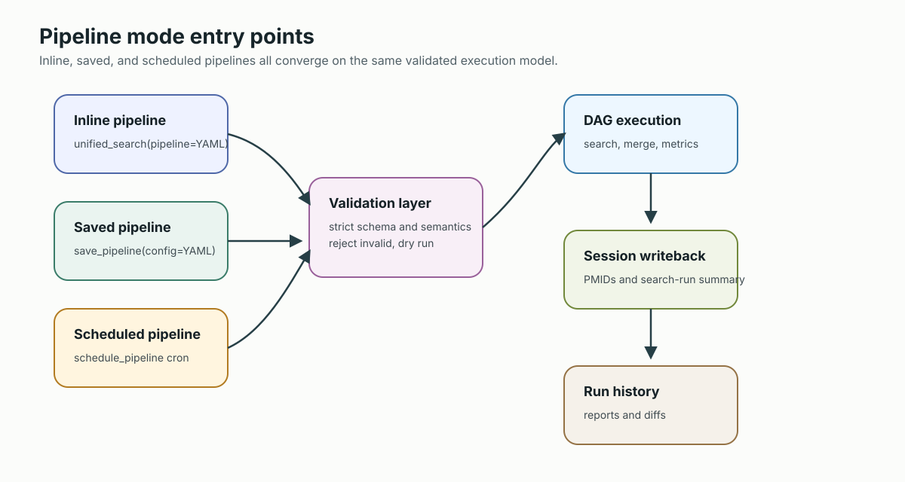
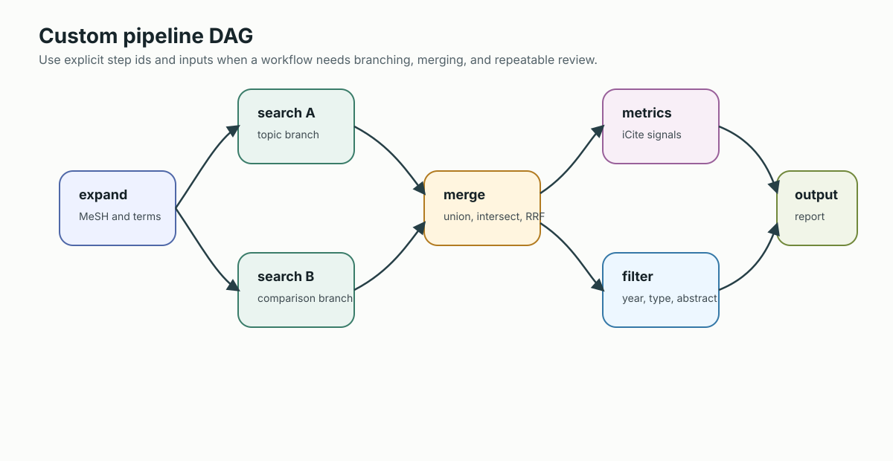

<!-- Synced from docs/guides/PIPELINE_MODE_TUTORIAL.en.md by scripts/build_docs_site.py -->

# Pipeline Mode Tutorial

> Status: current API tutorial
> Last updated: 2026-08-09
> Language: **English** | [繁體中文](pipeline-tutorial.zh-TW.md)

This document only describes pipeline mode behavior that is currently implemented and supported. It does not repeat older RFC or design-draft material. The focus is what you can execute now, save now, schedule now, and inspect through history now.

## Pipeline Mode Quick Start



Pipeline mode currently has 3 practical entry points:

1. Pass YAML or JSON directly into `unified_search(..., pipeline="...")`
2. Save the config with `save_pipeline`, then run it with `saved:<name>`
3. Save it first, then schedule recurring runs with `schedule_pipeline`

> **Choose the runtime first.** Trusted local stdio/loopback callers can use
> project workspace scope, `file:` sources, and the in-process scheduler.
> Authenticated service callers use only their principal-scoped saved-pipeline
> store: no process-wide workspace scope or `file:` reads. The service Compose
> profile disables the scheduler until an operator supplies a single external
> leader/lease.

### Smallest usable example: inline template

```python
unified_search(
    query="",
    pipeline="""
template: pico
template_params:
  P: ICU patients requiring mechanical ventilation
  I: remimazolam
  C: propofol
  O: sedation adequacy
output:
  format: markdown
  limit: 20
  ranking: balanced
""",
)
```

Notes:

- `unified_search` still requires `query` in the function signature, but once `pipeline` is set, ordinary search parameters are generally ignored. The safe pattern is `query=""`.
- `output_format="json"` forces structured JSON. `output.format: json` inside the pipeline also returns structured JSON.
- `dry_run=True` previews the resolved DAG without external searches. `stop_at="<step_id>"` executes only through that step.

### Smallest usable example: save first, then execute

```python
save_pipeline(
    name="icu_remi_vs_propofol",
    config="""
template: pico
template_params:
  P: ICU patients requiring mechanical ventilation
  I: remimazolam
  C: propofol
  O: delirium, sedation quality
output:
  limit: 25
  ranking: quality
""",
    tags=["icu", "sedation", "remimazolam"],
    description="ICU sedation comparison",
)

unified_search(query="", pipeline="saved:icu_remi_vs_propofol")
```

### Structured output and continuation tools

Pipeline reports now include filter diagnostics and next-step handoffs. At the bottom of a Markdown report, the recommended continuation tools are:

- `read_session(request={"action":"pmids"})` for the run PMID set
- `prepare_export(pmids="last", format="ris")` for Zotero/EndNote/Mendeley-style citation handoff
- `save_literature_notes(pmids="last", note_format="wiki")` for local wiki/Foam-compatible Markdown notes

Use structured JSON when another agent or extension should consume articles directly:

```yaml
output:
  format: json
  limit: 20
  ranking: quality
```

The JSON response contains `summary`, `steps`, per-step `metadata`, and structured `articles`.

### Which entry point to use

| Situation | Recommended entry point |
| ---- | -------- |
| You only want to run it once quickly | inline `unified_search(..., pipeline="...")` |
| You want to reuse the same search strategy | `save_pipeline(...)` |
| You want history diffs or local scheduling | save first, then use `saved:<name>` or `schedule_pipeline` |
| A trusted local caller wants to load a YAML file | `load_pipeline(source="file:path/to/pipeline.yaml")` |
| An authenticated service caller wants reuse | save in the tenant store, then use `saved:<name>` |

## Template Pipeline Tutorial

Template pipelines cover roughly 80% of normal use cases. The YAML is not sent directly into the executor as-is. It is first expanded into a real step DAG.

### 5 templates currently available

| Template | Required parameters | Common optional parameters | Purpose |
| -------- | -------- | ------------ | ---- |
| `pico` | `P`, `I` | `C`, `O`, `sources`, `limit` | Clinical comparison question |
| `comprehensive` | `query` | `sources`, `limit`, `min_year`, `max_year` | Broad multi-source search |
| `exploration` | `pmid` | `limit` | Explore outward from one seed paper |
| `gene_drug` | `term` | `sources`, `limit`, `min_year`, `max_year` | Gene- or drug-focused search |
| `snowball` | `query` | `seed_limit`, `limit` | Multi-seed citing/reference expansion |

### Canonical `template_params`

Template pipelines accept exactly one parameter field: `template_params`.
The retired top-level `params` spelling is rejected instead of being rewritten.
Step-based DAGs continue to use `params` inside each individual step.

### `pico`

```yaml
template: pico
template_params:
  P: ICU patients requiring sedation
  I: remimazolam
  C: propofol
  O: delirium incidence, time to extubation
  sources: pubmed,europe_pmc
  limit: 30
output:
  ranking: quality
```

This expands automatically into:

```text
pico -> search_p
     -> search_i
     -> search_c   # Only appears when C is provided
     -> merged -> enriched
```

### `comprehensive`

```yaml
template: comprehensive
template_params:
  query: CRISPR gene therapy clinical trials
  sources: pubmed,openalex,europe_pmc
  limit: 30
  min_year: 2020
output:
  ranking: quality
```

The correct field today is `query`, not `topic`.

This runs `expand` first, then launches the original query and expanded query in parallel, and finally performs merge + metrics.

### `exploration`

```yaml
template: exploration
template_params:
  pmid: "37076210"
  limit: 25
output:
  ranking: impact
```

This pulls `related`, `citing`, and `references` from the same seed paper.

### `gene_drug`

```yaml
template: gene_drug
template_params:
  term: BRCA1 targeted therapy PARP inhibitors
  sources: pubmed,openalex
  limit: 20
  min_year: 2020
output:
  ranking: recency
```

The correct field today is `term`, not `topic`.

### `snowball`

```yaml
template: snowball
template_params:
  query: remimazolam ICU sedation
  seed_limit: 5
  limit: 20
```

Search → citing + references → union merge (including original search results).
`seed_limit` defaults to 5 (1–10); `limit` defaults to 20.

### Example files

You can directly inspect these examples:

- `data/pipeline_examples/pico_remimazolam_vs_propofol.yaml`
- `data/pipeline_examples/comprehensive_crispr_therapy.yaml`
- `data/pipeline_examples/exploration_seed_paper.yaml`
- `data/pipeline_examples/gene_drug_brca1.yaml`

## Custom DAG Tutorial



When templates are not enough, define `steps` directly.

### Minimum structure

```yaml
name: ai_anesthesiology_scan
steps:
  - id: expand
    action: expand
    params:
      topic: artificial intelligence anesthesiology

  - id: search_original
    action: search
    params:
      query: artificial intelligence anesthesiology
      sources: pubmed,openalex
      limit: 60
      min_year: 2020

  - id: search_mesh
    action: search
    inputs: [expand]
    params:
      strategy: mesh
      sources: pubmed,europe_pmc
      limit: 60
      min_year: 2020

  - id: merged
    action: merge
    inputs: [search_original, search_mesh]
    params:
      method: rrf

  - id: enriched
    action: metrics
    inputs: [merged]

  - id: filtered
    action: filter
    inputs: [enriched]
    params:
      min_year: 2021
      has_abstract: true

output:
  format: markdown
  limit: 30
  ranking: quality
```

### Step fields to remember

| Field | Required? | Meaning |
| ---- | ------ | ---- |
| `id` | Required | Exact unique step ID; it is never generated or repaired |
| `action` | Required | Only a fixed action set is currently accepted |
| `params` | Depends on action | Each action expects different parameters |
| `inputs` | Depends on action | Can only reference steps defined earlier |
| `on_error` | Optional | `skip` or `abort`, default is `skip` |

### Actions currently available

| Action | Common params | Meaning |
| ------ | ----------- | ---- |
| `search` | `query`, `sources`, `limit`, `min_year`, `max_year`; or `retrieval: exhaustive`, `max_records`, `fetch_metadata` | General literature search; exhaustive mode collects the complete PubMed set |
| `pico` | `P`, `I`, `C`, `O` | Build PICO elements and a combined query |
| `expand` | `topic` | Perform semantic expansion and MeSH strategy generation |
| `details` | `pmids` | Fetch detailed article metadata |
| `related` | `pmid`, `limit` | Find related articles |
| `citing` | `pmid`, `limit` | Find citing articles |
| `references` | `pmid`, `limit` | Find references |
| `metrics` | none | Add iCite metrics |
| `merge` | `method=union / intersection / rrf` | Merge multiple result streams |
| `filter` | `min_year`, `max_year`, `article_types`, `min_citations`, `has_abstract` | Post-processing filters with diagnostics |
| `block_analysis` | `query` or one input search step, `max_count_queries` | Count-only MeSH/concept block and term-contribution audit (never the record-producing step) |

`related`, `citing`, and `references` also accept `inputs` with `seed_limit`
(1–10), mutually exclusive with `pmid`. The first unique input PMIDs are seeds;
each consumes one budgeted external call. Each action dedupes the union, removes
seeds, and caps its output at `limit`.

### Shared globals and variables

Use `globals` for step parameter defaults and `variables` for `${name}` placeholders. Step-level params override globals.

```yaml
name: reusable_remi_pipeline
globals:
  sources: pubmed,europe_pmc
  limit: ${per_step_limit}
  min_year: ${start_year}
variables:
  topic: remimazolam ICU sedation
  per_step_limit: 50
  start_year: 2020
steps:
  - id: search_topic
    action: search
    params:
      query: ${topic}
  - id: filtered
    action: filter
    inputs: [search_topic]
    params:
      article_types: [RCT, systematic review]
      has_abstract: true
output:
  limit: 20
  ranking: quality
```

`article_types` accepts canonical values such as `randomized-controlled-trial` and common aliases such as `RCT`, `randomized controlled trial`, `systematic review`, and `meta analysis`. Unknown article type requests fail closed with a warning instead of silently disabling the filter. The filter report shows before/after counts, exclusion reasons, mappings, and examples of excluded articles.

### How `search` consumes upstream outputs

`search` does not always need its own `query`. It can derive the query from an upstream step:

- When upstream is `pico`, you can use `element: P|I|C|O`
- When upstream is `pico`, you can also use `use_combined: precision|recall|intervention_outcome|comparison_outcome`
- When upstream is `expand`, you can use `strategy: mesh` or another strategy name

### Dry-run and partial execution

Use `dry_run=True` before long pipelines or while editing variables:

```python
unified_search(query="", pipeline="<yaml>", dry_run=True)
```

Use `stop_at` to inspect an intermediate result set:

```python
unified_search(query="", pipeline="<yaml>", stop_at="merged")
```

`stop_at` is inclusive: the named step runs, downstream steps are skipped. This is useful when you want to inspect a PICO merge before adding filters or metrics.

### Full DAG example

For a longer multi-step example, see:

- `data/pipeline_examples/ai_in_anesthesiology.yaml`

## Single-purpose pipeline tools

Pipeline management deliberately uses seven schema-exact tools. Each operation
exposes only its own valid arguments, so misspelled or irrelevant fields fail
closed under the v3 MCP contract.

### List

```python
list_pipelines()
list_pipelines(tag="sedation")
list_pipelines(scope="workspace")
```

### Save

```python
save_pipeline(
    name="weekly_remimazolam",
    config="""
template: comprehensive
template_params:
  query: remimazolam ICU sedation
  sources: pubmed,openalex,europe_pmc
  limit: 30
""",
    tags=["sedation", "icu"],
    description="Weekly remimazolam surveillance",
    scope="workspace",
)
```

`config` must parse to a YAML/JSON mapping, not a list or scalar. `tags` is a
JSON array of at most 20 strict strings; CSV text is rejected.

`scope` behavior:

- local `workspace`: saved under `.pubmed-search/pipelines/` inside the project.
  When the server creates `.pubmed-search/` it also writes a `.gitignore` there
  that ignores everything (run record sets carry titles and abstracts, and the
  screening log holds reviewers' decisions); an existing directory or
  `.gitignore` is never changed. To share saved pipelines through git, replace
  that file; it contains a recipe that keeps only `pipelines/*.yaml`.
- local `global`: saved under the user data directory `~/.pubmed-search-mcp/pipelines/`
- local `auto`: save to workspace when available, otherwise global
- authenticated service: the tenant-derived store deliberately has no
  process-wide workspace root; `auto` resolves to that principal's isolated
  data root and `workspace` is unavailable

A workspace pipeline shadows a global pipeline of the same name: running,
history, export and screening by that name use the workspace one, and
`save_pipeline`/`list_pipelines`/`delete_pipeline` say so. A run always stays
in the scope its pipeline was loaded from.

### Load

```python
load_pipeline(source="weekly_remimazolam")
load_pipeline(source="saved:weekly_remimazolam")
load_pipeline(source="file:data/pipeline_examples/pico_remimazolam_vs_propofol.yaml")
```

`load_pipeline` currently supports:

- saved names
- `saved:<name>`
- local-only `file:path/to/pipeline.yaml`

Authenticated service callers cannot read `file:` paths from the server host;
save the YAML by name first. Direct URL loading is not currently part of the
supported contract.

### Delete

```python
delete_pipeline(name="weekly_remimazolam")
```

### History

```python
get_pipeline_history(name="weekly_remimazolam", limit=10)
```

### Schedule

```python
schedule_pipeline(
    name="weekly_remimazolam",
    cron="0 9 * * 1",
    diff_mode=True,
    notify=True,
)
```

### Unschedule

```python
unschedule_pipeline(name="weekly_remimazolam")
```

## Schedule and History

### Recommended flow

1. Save the pipeline first
2. Use `unified_search(query="", pipeline="saved:<name>")` for manual execution
3. Use `schedule_pipeline(...)` for recurring runs
4. Use `get_pipeline_history(name="...")` to inspect run history

### Scheduling

The examples below require a trusted local process with the scheduler enabled.
`docker-compose.service.yml` disables the in-process scheduler. Storing schedule
metadata in a service does not make it execute; use manual runs or provide one
external leader/lease before enabling recurring execution.

```python
schedule_pipeline(name="weekly_remimazolam", cron="0 9 * * 1")
schedule_pipeline(name="monthly_crispr_review", cron="0 8 1 * *")
schedule_pipeline(name="watch_icu_sedation", cron="0 */6 * * *")
```

`diff_mode=True` (default) appends changes since the previous successful run,
with up to 20 new articles and 20 removed PMIDs; the first run is a baseline.
Partial/error runs do not imply removals. `notify=True` (default) retains the last
run ID and new/removed counts. `list_pipelines` shows "N new articles in the last
scheduled run" with a `get_pipeline_history` hint. Notification is a local
summary and log, not external push; disabling it clears the old summary.
Manual execution keeps its existing report format.

Cron format is the standard 5-field form:

```text
minute hour day month weekday
```

To remove a schedule:

```python
unschedule_pipeline(name="weekly_remimazolam")
```

### History

```python
get_pipeline_history(name="weekly_remimazolam", limit=5)
```

History shows:

- execution time
- total article count
- how many articles were added compared with the previous run
- how many were removed
- retrieval mode, PubMed total and strategy hash (config hash / executed-query hash)
- success or failure status

Use `view="run"`, `view="prisma_s"` and `view="records"` for one run's provenance, a PRISMA-S
table and the persisted record set (see the systematic review section below).

### Current limitations

- There is no standalone `list_schedules()` MCP tool yet
- If you want stable history and diffs, prefer saved pipelines over one-off inline pipelines
- Service mode stays single-process/single-replica, and its Compose profile does
  not run scheduled pipelines

## Systematic Review and Meta-analysis Mode

A bounded relevance window (`limit` ≤ 100) cannot support screening or a PRISMA
flow diagram. For a systematic search, save the strategy as a pipeline whose
PubMed search step uses `retrieval: exhaustive`, then let the run record, export
and screening tools work on the complete record set.

```yaml
steps:
  - id: pubmed
    action: search
    params:
      query: >-
        ("Anesthesia Recovery Period"[Mesh] OR PACU[tiab] OR emergence[tiab])
        AND ("Consciousness Monitors"[Mesh] OR "bispectral index"[tiab])
        AND ("Delirium"[Mesh] OR delirium[tiab])
        NOT (("Child"[Mesh] OR "Infant"[Mesh]) NOT "Adult"[Mesh])
      sources: [pubmed]
      retrieval: exhaustive     # complete PMID set via the E-utilities History Server
      max_records: 10000        # disclosed safety cap (default and maximum 10000)
      fetch_metadata: true      # default: EFetch metadata in batches for export
  - id: blocks
    action: block_analysis      # optional strategy audit (count-only queries)
    inputs: [pubmed]
    params:
      max_count_queries: 60     # default 60, maximum 200
output:
  format: json
  limit: 20                     # size of the ranked preview, not of the record set
```

```python
save_pipeline(name="pacu_peeg_ma", config="<yaml above>", scope="workspace")
unified_search(pipeline="saved:pacu_peeg_ma")
```

### What exhaustive retrieval guarantees

- One ESearch creates a History Server snapshot; every page of PMIDs is read
  from that snapshot with EFetch `rettype=uilist`. Each provider operation
  (snapshot, PMID page, metadata batch) reserves one unit of the run budget.
- PubMed's ESearch cannot page beyond 10,000 records. A count above
  `max_records` is **refused, not truncated**; narrow the strategy (for example
  with `min_year`/`max_year`) or split it into several saved pipelines.
- If paging stops early (deadline or quota), the step fails as incomplete; no
  partial set is reported as exhaustive. If only metadata batches run out, the
  PMID set stays complete and export fetches the missing metadata on demand.
  The run deadline is handled the same way: metadata stops two seconds before
  it and the step keeps its complete PMID set, with
  `metadata_error: {"kind": "deadline"}`.
- `retrieval.exhaustive` describes the run's final record set: it is true only
  when every search feeding that set is exhaustive and complete. Merging an
  exhaustive step with a bounded search (or `related`, `citing`, `references`,
  `details`) gives `mode: "mixed"`, `exhaustive: false`, the `bounded_steps`
  and a warning, and the run is not registered as complete identification. A
  bounded search that does not feed the final set does not change the claim.
- `filter` cannot judge records without metadata (`fetch_metadata: false` or
  interrupted metadata). Every filter type keeps them and reports
  `metadata_missing` (count and PMID preview) instead of dropping them.
- MeSH correction suggestions run only after every step has finished, so they
  never take provider calls that required retrieval still needs.
- `limit` and other sources are rejected with `retrieval: exhaustive`; the
  strategy must be saved first (`dry_run=True` still validates inline configs).
- The response is a bounded summary: total and retrieved counts, the
  exhaustive flag, a preview of the first 20 ranked records, the run ID and the
  next calls to make. The full set is persisted with the run.

### Run record (PRISMA-S provenance)

Each saved run stores, per search step and database: database and platform,
the strategy as saved, the executed query with limits, PubMed's
`QueryTranslation` (exhaustive steps), phrases PubMed could not find, total and
retrieved counts, the exhaustive flag, filters, UTC search time, the server
version, the saved config hash, a SHA-256 over an immutable config snapshot and
any block analysis. Editing the YAML later never rewrites an earlier run.

```python
get_pipeline_history(name="pacu_peeg_ma")                      # Strategy column: config/query hash
get_pipeline_history(name="pacu_peeg_ma", view="run")          # one run's provenance (JSON)
get_pipeline_history(name="pacu_peeg_ma", view="prisma_s")     # PRISMA-S table: Markdown + CSV
get_pipeline_history(name="pacu_peeg_ma", view="records", offset=0, limit=100)  # page the full set
prepare_export(pipeline_run="pacu_peeg_ma", format="ris")      # latest run; also csv, csl, bibtex, medline, json
prepare_export(pipeline_run="pacu_peeg_ma@<run_id>", format="csv")
```

Run exports go through the same export layer as `prepare_export(pmids=...)` and
preserve PMIDs (RIS `AN`, CSV `PMID`, CSL-JSON `PMID` and `id: pmid:<PMID>`) for
Rayyan, Covidence or Zotero import. The export's `pipeline_run` summary states
`record_basis`, `retrieval_mode` and `complete_record_set`; a ranked preview, a
mixed or an incomplete run is exported with a warning. `view="records"` pages
every persisted record, including merged sets above 10,000 records. If a run
record cannot be saved, the `unified_search` response says so
(`persistence.saved: false`) instead of showing an empty record set.

### Strategy block analysis

`block_analysis` splits a strategy into top-level AND blocks of OR terms (plus
NOT blocks) and runs count-only searches for: the full strategy, each block
alone, cumulative AND combinations, records removed by each NOT block, and each
term's unique contribution (records lost if that term is removed from its
block, within the full strategy). A zero contribution is a prompt to review a
term, not proof that it is useless. Quoted phrases, field tags, wildcards,
subheadings and nested parentheses are kept verbatim. PubMed evaluates operators
left to right, so a top level that mixes `OR` with `AND`/`NOT` is reported as
not decomposable instead of being guessed. Count queries have their own quota
(200 per run) and still respect the run deadline; truncation is disclosed.

### Screening and PRISMA 2020 flow

Runs that identified a complete set are registered for screening
automatically, so records first found by a later update run enter the
title/abstract queue on their own.

```python
pipeline_screening(request={"action": "queue", "pipeline": "pacu_peeg_ma", "include_abstract": True})
pipeline_screening(request={
    "action": "record",
    "pipeline": "pacu_peeg_ma",
    "decisions": [
        {"pmid": "12345678", "stage": "title_abstract", "decision": "include", "reviewer": "ak"},
        {"pmid": "23456789", "stage": "title_abstract", "decision": "exclude", "reason": "paediatric", "reviewer": "ak"},
    ],
})
pipeline_screening(request={"action": "record", "pipeline": "pacu_peeg_ma", "decisions": [
    {"pmid": "12345678", "stage": "full_text", "decision": "exclude", "reason": "no pEEG arm"},
]})
pipeline_screening(request={"action": "flow", "pipeline": "pacu_peeg_ma"})   # Markdown; format="json" for data
```

- Decisions are append-only; the latest decision per PMID and stage counts and
  earlier ones remain in `{"action": "log"}`. Different reviewer labels that
  disagree are reported as conflicts.
- Without `decision_id`, a decision is a replay only when it repeats the same
  reviewer's latest decision for that PMID and stage (same decision, reason and
  note). Anything else, including a return to an earlier decision
  (include → exclude → include), is recorded and counted. Pass a stable
  `decision_id` to make a retried request idempotent even after later
  decisions. A batch is all-or-nothing.
- Full-text exclusions need a reason; use `not retrieved` for reports that
  could not be obtained. Full-text screening needs a prior title/abstract
  `include` or `maybe`.
- `flow` reports records identified per run and database (the search result
  before pipeline `filter` steps), records marked ineligible by automation tools
  (removed by those filters), duplicates removed across runs, screened,
  excluded, reports sought, not retrieved, assessed, excluded with reasons, and
  included, plus new unscreened records per run.
- Use `{"action": "register_run"}` to add an older or bounded run explicitly;
  the flow then warns that identification is incomplete.
- `delete_pipeline` removes the run history and record sets. If the screening log holds
  decisions it refuses and removes nothing, reporting how many decisions and PMIDs would be
  lost; export them with `{"action": "log"}` first, then pass `delete_screening_log=true`.
  A log without decisions is removed with the pipeline. The check is atomic with
  the deletion, so a decision recorded meanwhile still blocks it; if a file is
  locked (for example on Windows), deletion stops with the pipeline intact and
  can be retried.

## Validation and exact bounds

Pipeline identifiers, types, and enum-like values are schema-exact. The
validator does not coerce scalar types, clip explicit values, or guess caller
intent from aliases, spelling similarity, or nearby step IDs. Published safety
bounds are validation constraints, not normalization rules.

`output.format: json` is a canonical valid format and remains unchanged.

### Cases that fail without repair

| Problem | Why it fails |
| ---- | ---- |
| retired template field `params` | use canonical `template_params` |
| unknown or misspelled template | only the four canonical template names are accepted |
| unknown or misspelled action | only the ten canonical action names are accepted |
| missing or duplicate step ID | step identity is never generated or rewritten |
| unknown or future dependency ID | dependency references are never guessed or removed |
| invalid `on_error`, output format, or ranking | enum-like values are never substituted |
| output/action/template limit below or above its published range | explicit limits are never defaulted or clipped |
| wrong types or explicit `null` | values are never coerced to strings, lists, mappings, or integers |
| template is missing required parameters | for example, `pico` without `P` or `I` |
| there are no `steps` and no `template` | nothing executable remains |
| more than 20 steps | exceeds the system limit |

### One intentionally broken example

```yaml
template: clinical
template_params:
  P: ICU patients
  I: remimazolam
output:
  format: xml
  limit: 0
  ranking: impac
```

This config is rejected. Write the intended canonical values explicitly:

```yaml
template: pico
template_params:
  P: ICU patients
  I: remimazolam
output:
  format: markdown
  limit: 20
  ranking: impact
```

### Practical recommendations

1. Validate with `dry_run=True` before saving or scheduling a long pipeline.
2. Use inline template pipelines only for small parameter sets. For review and versioning, save YAML files.
3. Start custom DAGs from the smallest runnable graph, then add `merge`, `metrics`, and `filter` incrementally.
4. In local mode, use `scope="workspace"` when the pipeline should be shared in a trusted repo.
5. In local mode, use `scope="global"` for your own reusable search habits across projects.
6. In authenticated service mode, omit workspace/file paths and reuse named pipelines from the current tenant store.
7. Keep Zotero Keeper integration outside PubMed MCP core. PubMed MCP should produce RIS/CSL/JSON/wiki notes; Zotero Keeper or another external client should handle Zotero import, duplicate policy, and library-specific behavior.
