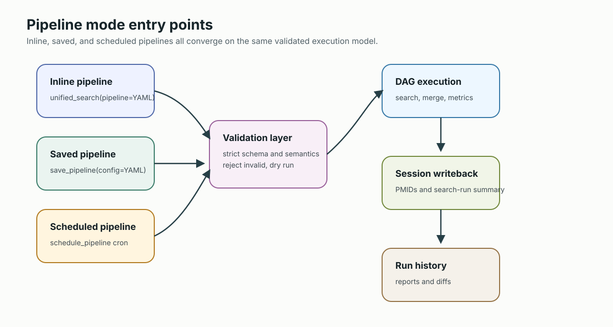
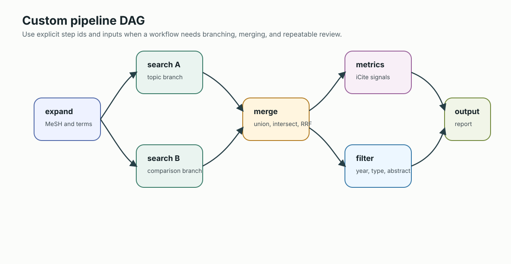

<!-- Synced from docs/guides/PIPELINE_MODE_TUTORIAL.md by scripts/build_docs_site.py -->

# Pipeline Mode Tutorial

> Status: current API tutorial
> Last updated: 2026-08-09
> Language: [English](pipeline-tutorial.md) | **繁體中文**

這份文件只描述目前真的可用的 pipeline mode 行為，不重複 RFC 設計稿。重點是直接可執行、可保存、可排程、可查歷史。

## Pipeline Mode 快速上手



Pipeline mode 有 3 種最常用入口：

1. 直接把 YAML/JSON 丟給 `unified_search(..., pipeline="...")`
2. 先用 `save_pipeline` 保存，再用 `saved:<name>` 執行
3. 保存後交給 `schedule_pipeline` 定期跑

> **先選擇 runtime。** 可信任的本機 stdio/loopback caller 可使用 project workspace
> scope、`file:` source 與 in-process scheduler。認證 service caller 只使用當前
> principal 隔離的 saved-pipeline store：不存取 process-wide workspace，也不讀
> `file:`。Service Compose 會停用 scheduler，直到維運者提供單一 external leader/lease。

### 最短可用範例: inline template

```python
unified_search(
    query="",
    pipeline="""
template: pico
template_params:
  P: ICU patients requiring mechanical ventilation
  I: remimazolam
  C: propofol
  O: sedation adequacy
output:
  format: markdown
  limit: 20
  ranking: balanced
""",
)
```

注意:

- `unified_search` 在函式簽名上仍要求 `query`，但只要設定了 `pipeline`，一般搜尋參數會被忽略。保守寫法就是 `query=""`。
- `output_format="json"` 會強制回 structured JSON。pipeline 內的 `output.format: json` 也會回 structured JSON。
- `dry_run=True` 會預覽解析後的 DAG，不做外部搜尋。`stop_at="<step_id>"` 則只執行到指定 step。

### 最短可用範例: 先保存再執行

```python
save_pipeline(
    name="icu_remi_vs_propofol",
    config="""
template: pico
template_params:
  P: ICU patients requiring mechanical ventilation
  I: remimazolam
  C: propofol
  O: delirium, sedation quality
output:
  limit: 25
  ranking: quality
""",
    tags=["icu", "sedation", "remimazolam"],
    description="ICU sedation comparison",
)

unified_search(query="", pipeline="saved:icu_remi_vs_propofol")
```

### Structured output 與後續工具

Pipeline Markdown report 會包含 filter diagnostics，也會在底部附上後續 handoff 建議：

- `read_session(request={"action":"pmids"})` 取回這次 run 的 PMID set
- `prepare_export(pmids="last", format="ris")` 交給 Zotero/EndNote/Mendeley 類引用管理器
- `save_literature_notes(pmids="last", note_format="wiki")` 存成本機 wiki/Foam-compatible Markdown 筆記

如果要讓另一個 agent 或 extension 直接吃結構化文章資料，用 JSON：

```yaml
output:
  format: json
  limit: 20
  ranking: quality
```

JSON 回應會包含 `summary`、`steps`、每個 step 的 `metadata`、以及 structured `articles`。

### 什麼時候用哪一種

| 情境 | 推薦入口 |
| ---- | -------- |
| 只想快速跑一次 | inline `unified_search(..., pipeline="...")` |
| 想重複使用同一個搜尋策略 | `save_pipeline(...)` |
| 想看歷史 diff 或本機排程 | 先保存，再用 `saved:<name>` / `schedule_pipeline` |
| 可信任的本機 caller 想從 YAML 檔載入 | `load_pipeline(source="file:path/to/pipeline.yaml")` |
| 認證 service caller 要重用 | 存入 tenant store，再用 `saved:<name>` |

## Template Pipeline 教學

Template pipeline 適合 80% 的常見需求。它不是把 YAML 原封不動送進 executor，而是先展開成真正的 step DAG。

### 目前可用的 5 個 templates

| Template | 必填參數 | 常用可選參數 | 用途 |
| -------- | -------- | ------------ | ---- |
| `pico` | `P`, `I` | `C`, `O`, `sources`, `limit` | 臨床比較問題 |
| `comprehensive` | `query` | `sources`, `limit`, `min_year`, `max_year` | 多來源全面搜尋 |
| `exploration` | `pmid` | `limit` | 從一篇 seed paper 往外探索 |
| `gene_drug` | `term` | `sources`, `limit`, `min_year`, `max_year` | 基因或藥物主題搜尋 |
| `snowball` | `query` | `seed_limit`, `limit` | 多種子 citing／references 擴展 |

### Canonical `template_params`

Template pipeline 只接受唯一的參數欄位 `template_params`。已退役的頂層
`params` 會直接被拒絕，不會自動改寫；step-based DAG 內每個 step 仍使用
`params`。

### `pico`

```yaml
template: pico
template_params:
  P: ICU patients requiring sedation
  I: remimazolam
  C: propofol
  O: delirium incidence, time to extubation
  sources: [pubmed, europe_pmc]
  limit: 30
output:
  ranking: quality
```

這會自動展開成:

```text
pico -> search_p
     -> search_i
     -> search_c   # 只有設定 C 才會出現
     -> merged -> enriched
```

### `comprehensive`

```yaml
template: comprehensive
template_params:
  query: CRISPR gene therapy clinical trials
  sources: [pubmed, openalex, europe_pmc]
  limit: 30
  min_year: 2020
output:
  ranking: quality
```

注意目前正確欄位是 `query`，不是 `topic`。

這會先做 `expand`，再平行跑原始查詢與擴展查詢，最後 merge + metrics。

### `exploration`

```yaml
template: exploration
template_params:
  pmid: "37076210"
  limit: 25
output:
  ranking: impact
```

這會從同一篇 seed paper 同步拉 `related`、`citing`、`references`。

### `gene_drug`

```yaml
template: gene_drug
template_params:
  term: BRCA1 targeted therapy PARP inhibitors
  sources: [pubmed, openalex]
  limit: 20
  min_year: 2020
output:
  ranking: recency
```

注意目前正確欄位是 `term`，不是 `topic`。

### `snowball`

```yaml
template: snowball
template_params:
  query: remimazolam ICU sedation
  seed_limit: 5
  limit: 20
```

流程：search → citing + references → union merge（含原始搜尋結果）。
`seed_limit` 預設 5（1–10）；`limit` 預設 20。

### 範例檔

目前可直接參考這些範例:

- `data/pipeline_examples/pico_remimazolam_vs_propofol.yaml`
- `data/pipeline_examples/comprehensive_crispr_therapy.yaml`
- `data/pipeline_examples/exploration_seed_paper.yaml`
- `data/pipeline_examples/gene_drug_brca1.yaml`

## Custom DAG 教學



當 template 不夠時，直接寫 `steps`。

### 最小結構

```yaml
name: ai_anesthesiology_scan
steps:
  - id: expand
    action: expand
    params:
      topic: artificial intelligence anesthesiology

  - id: search_original
    action: search
    params:
      query: artificial intelligence anesthesiology
      sources: [pubmed, openalex]
      limit: 60
      min_year: 2020

  - id: search_mesh
    action: search
    inputs: [expand]
    params:
      strategy: mesh
      sources: [pubmed, europe_pmc]
      limit: 60
      min_year: 2020

  - id: merged
    action: merge
    inputs: [search_original, search_mesh]
    params:
      method: rrf

  - id: enriched
    action: metrics
    inputs: [merged]

  - id: filtered
    action: filter
    inputs: [enriched]
    params:
      min_year: 2021
      has_abstract: true

output:
  format: markdown
  limit: 30
  ranking: quality
```

### 每個 step 要記得的事

| 欄位 | 必要性 | 說明 |
| ---- | ------ | ---- |
| `id` | 必填 | 精確且唯一的 step ID；不會自動產生或修復 |
| `action` | 必填 | 目前只接受固定 action 集合 |
| `params` | 視 action 而定 | 各 action 需要的參數不同 |
| `inputs` | 視 action 而定 | 只能引用前面已定義的 step |
| `on_error` | 可選 | `skip` 或 `abort`，預設 `skip` |

### 目前可用 actions

| Action | 常用 params | 說明 |
| ------ | ----------- | ---- |
| `search` | `query`, `sources`, `limit`, `min_year`, `max_year`；或 `retrieval: exhaustive`, `max_records`, `fetch_metadata` | 一般文獻搜尋；exhaustive 模式取回完整 PubMed 集合 |
| `pico` | `P`, `I`, `C`, `O` | 建立 PICO elements 與組合 query |
| `expand` | `topic` | 做語意擴展與 MeSH strategy |
| `details` | `pmids` | 補抓文章詳情 |
| `related` | `pmid`, `limit` | 找 related articles |
| `citing` | `pmid`, `limit` | 找 citing articles |
| `references` | `pmid`, `limit` | 找 references |
| `metrics` | 無需額外 params | 補 iCite metrics |
| `merge` | `method=union / intersection / rrf` | 合併多路結果 |
| `filter` | `min_year`, `max_year`, `article_types`, `min_citations`, `has_abstract` | 帶 diagnostics 的後處理篩選 |
| `block_analysis` | `query` 或一個 input search step、`max_count_queries` | 僅計數的 MeSH／概念區塊與詞彙貢獻稽核（不會成為產生紀錄集的步驟） |

`related`／`citing`／`references` 也支援 `inputs` + `seed_limit`（1–10），
與 `pmid` 互斥。依輸入順序取前幾個不重複 PMID，每個 seed 消耗一次外部呼叫預算；
各 action 合併去重、排除 seeds 後，以 `limit` 截斷輸出。

### Shared globals 與 variables

`globals` 是每個 step 會繼承的預設 params；`variables` 可以在字串中用 `${name}` 替換。step 自己的 params 會覆蓋 globals。

```yaml
name: reusable_remi_pipeline
globals:
  sources: [pubmed, europe_pmc]
  limit: ${per_step_limit}
  min_year: ${start_year}
variables:
  topic: remimazolam ICU sedation
  per_step_limit: 50
  start_year: 2020
steps:
  - id: search_topic
    action: search
    params:
      query: ${topic}
  - id: filtered
    action: filter
    inputs: [search_topic]
    params:
      article_types: [randomized-controlled-trial, systematic-review]
      has_abstract: true
output:
  limit: 20
  ranking: quality
```

`article_types` 支援 canonical 值，例如 `randomized-controlled-trial`，也支援常見 alias，例如 `RCT`、`randomized controlled trial`、`systematic review`、`meta analysis`。未知 article type 會 fail closed 並附 warning，不會默默關掉 type filter。Filter report 會顯示篩選前後數量、排除原因、article type mapping、以及被排除文章範例。

### `search` 會怎麼吃上游結果

`search` 不一定要自己寫 `query`，它也能從上游 step 導出 query:

- 上游是 `pico` 時，可用 `element: P|I|C|O`
- 上游是 `pico` 時，也可用 `use_combined: precision|recall|intervention_outcome|comparison_outcome`
- 上游是 `expand` 時，可用 `strategy: mesh` 或其他 strategy 名稱

### Dry-run 與部分執行

長 pipeline 或正在調整 variables 時，先用 `dry_run=True`：

```python
unified_search(query="", pipeline="<yaml>", dry_run=True)
```

要查看中間結果，用 `stop_at`：

```python
unified_search(query="", pipeline="<yaml>", stop_at="merged")
```

`stop_at` 是 inclusive：指定的 step 會執行，下游 step 會跳過。這很適合先檢查 PICO merge，再決定要不要加 filter 或 metrics。

### 完整 DAG 範例

完整多步驟範例可看:

- `data/pipeline_examples/ai_in_anesthesiology.yaml`

## 單一職責 Pipeline 工具

Pipeline 管理刻意拆成七個 schema-exact tools。每個 operation 只暴露自己的合法
arguments；拼錯或不相關的欄位會依 v3 MCP contract fail closed。

### 列表

```python
list_pipelines()
list_pipelines(tag="sedation")
list_pipelines(scope="workspace")
```

### 保存

```python
save_pipeline(
    name="weekly_remimazolam",
    config="""
template: comprehensive
template_params:
  query: remimazolam ICU sedation
  sources: [pubmed, openalex, europe_pmc]
  limit: 30
""",
    tags=["sedation", "icu"],
    description="Weekly remimazolam surveillance",
    scope="workspace",
)
```

`config` 必須 parse 成 YAML/JSON mapping，不能是 list 或 scalar。`tags` 必須是
最多 20 個 strict strings 的 JSON array；CSV text 會被拒絕。

`scope` 行為:

- 本機 `workspace`：存在專案底下 `.pubmed-search/pipelines/`。server 建立 `.pubmed-search/`
  時會在其中寫入忽略全部內容的 `.gitignore`（run 紀錄集含標題與摘要，篩選紀錄是審查者的決策）；
  已存在的目錄或 `.gitignore` 不會被改動。要以 git 分享已保存的 pipeline，請改寫該檔，
  檔內附有只保留 `pipelines/*.yaml` 的範例。
- 本機 `global`：存在使用者資料目錄 `~/.pubmed-search-mcp/pipelines/`
- 本機 `auto`：有 workspace 就存 workspace，否則 global
- 認證 service：tenant-derived store 刻意沒有 process-wide workspace root；
  `auto` 會解析到該 principal 隔離的 data root，`workspace` 不可用

同名的 workspace pipeline 會遮蔽 global pipeline：以該名稱執行、查歷史、匯出與篩選都使用
workspace 那一個，`save_pipeline`／`list_pipelines`／`delete_pipeline` 會明確提示。
每次 run 一律留在載入其 pipeline 的 scope。

### 載入

```python
load_pipeline(source="weekly_remimazolam")
load_pipeline(source="saved:weekly_remimazolam")
load_pipeline(source="file:data/pipeline_examples/pico_remimazolam_vs_propofol.yaml")
```

目前 `load_pipeline` 支援:

- 已保存名稱
- `saved:<name>`
- 僅本機的 `file:path/to/pipeline.yaml`

認證 service caller 不能從 server host 讀取 `file:` path；請先以名稱存入 YAML。
目前不承諾直接從 URL 載入。

### 刪除

```python
delete_pipeline(name="weekly_remimazolam")
```

### 歷史

```python
get_pipeline_history(name="weekly_remimazolam", limit=10)
```

### 排程

```python
schedule_pipeline(
    name="weekly_remimazolam",
    cron="0 9 * * 1",
    diff_mode=True,
    notify=True,
)
```

### 移除排程

```python
unschedule_pipeline(name="weekly_remimazolam")
```

## Schedule 與 History

### 正確流程

1. 先保存 pipeline
2. 手動執行用 `unified_search(query="", pipeline="saved:<name>")`
3. 定期執行用 `schedule_pipeline(...)`
4. 看歷史用 `get_pipeline_history(name="...")`

### 排程

下列範例需要已啟用 scheduler 的可信任本機 process。`docker-compose.service.yml`
會停用 in-process scheduler；在 service 中存下 schedule metadata 不代表它會自動執行。
啟用 recurring execution 前，請改用手動 run 或提供單一 external leader/lease。

```python
schedule_pipeline(name="weekly_remimazolam", cron="0 9 * * 1")
schedule_pipeline(name="monthly_crispr_review", cron="0 8 1 * *")
schedule_pipeline(name="watch_icu_sedation", cron="0 */6 * * *")
```

`diff_mode=True`（預設）在報告附上與前次成功執行的差異：新增文章與移除 PMID
各最多 20 筆，首次為 baseline；partial/error 不據以推論移除。
`notify=True`（預設）保存最後 run ID 與新增／移除數量；`list_pipelines` 顯示
「N new articles in the last scheduled run」並引導至 `get_pipeline_history`。
通知是本機摘要與 log，不是外部推播；停用時清除舊摘要。手動執行的報告格式不變。

Cron 格式是標準 5 欄位:

```text
minute hour day month weekday
```

移除排程:

```python
unschedule_pipeline(name="weekly_remimazolam")
```

### history

```python
get_pipeline_history(name="weekly_remimazolam", limit=5)
```

history 會顯示:

- 執行時間
- 文章總數
- 相較前一次新增多少篇
- 移除多少篇
- 取回模式、PubMed 總數與策略 hash（config hash／實際查詢 hash）
- 成功或失敗狀態

單一 run 的來源資訊、PRISMA-S 表與保存的紀錄集請用 `view="run"`、`view="prisma_s"`、
`view="records"`（見下方系統性回顧章節）。

### 現況限制

- 目前沒有獨立的 `list_schedules()` MCP tool
- 想要穩定追蹤 history / diff，請優先使用「已保存 pipeline」而不是臨時 inline pipeline
- Service mode 保持單 process/單 replica，且其 Compose profile 不執行 scheduled pipelines

## 系統性回顧與統合分析模式

有界的相關性視窗（`limit` ≤ 100）無法支撐篩選或 PRISMA 流程圖。系統性檢索請把策略保存成
pipeline，PubMed search step 設 `retrieval: exhaustive`，再由 run 紀錄、匯出與篩選工具處理完整紀錄集。

```yaml
steps:
  - id: pubmed
    action: search
    params:
      query: >-
        ("Anesthesia Recovery Period"[Mesh] OR PACU[tiab] OR emergence[tiab])
        AND ("Consciousness Monitors"[Mesh] OR "bispectral index"[tiab])
        AND ("Delirium"[Mesh] OR delirium[tiab])
        NOT (("Child"[Mesh] OR "Infant"[Mesh]) NOT "Adult"[Mesh])
      sources: [pubmed]
      retrieval: exhaustive     # 透過 E-utilities History Server 取得完整 PMID 集合
      max_records: 10000        # 公開的安全上限（預設與最大值皆為 10000）
      fetch_metadata: true      # 預設：分批 EFetch metadata 供匯出
  - id: blocks
    action: block_analysis      # 選用的策略稽核（僅計數查詢）
    inputs: [pubmed]
    params:
      max_count_queries: 60     # 預設 60，最大 200
output:
  format: json
  limit: 20                     # 排序預覽的筆數，不是紀錄集大小
```

```python
save_pipeline(name="pacu_peeg_ma", config="<上方 yaml>", scope="workspace")
unified_search(pipeline="saved:pacu_peeg_ma")
```

### exhaustive 取回的保證

- 一次 ESearch 建立 History Server snapshot，所有 PMID 頁面都以 EFetch `rettype=uilist`
  從同一 snapshot 讀取。每個 provider 操作（snapshot、PMID 頁、metadata 批次）都先預留一單位 run 預算。
- PubMed ESearch 無法翻頁超過 10,000 筆。筆數超過 `max_records` 時**直接拒絕，不會截斷**；
  請收斂策略（例如 `min_year`/`max_year`）或拆成多個 saved pipelines。
- 翻頁中途停止（deadline 或配額）時，step 以不完整失敗，不會把部分集合當成完整結果。
  若只有 metadata 批次用完預算，PMID 集合仍完整，匯出時會再補抓缺少的 metadata。
  run deadline 也一樣：metadata 在期限前兩秒停止，step 保留完整 PMID 集合並標示
  `metadata_error: {"kind": "deadline"}`。
- `retrieval.exhaustive` 描述 run 的最終紀錄集：只有餵入該集合的每個檢索都是完整的 exhaustive
  取回時才為 true。exhaustive step 與有界搜尋（或 `related`、`citing`、`references`、`details`）
  合併時為 `mode: "mixed"`、`exhaustive: false`，列出 `bounded_steps` 並附警告，
  也不會被登記為完整識別。不餵入最終集合的有界搜尋不影響此判定。
- `filter` 無法判斷沒有 metadata 的紀錄（`fetch_metadata: false` 或 metadata 中斷）；
  每種 filter 都會保留它們並回報 `metadata_missing`（筆數與 PMID 預覽），不會默默丟棄。
- MeSH 校正建議在所有 step 完成後才執行，不會占用必要取回仍需要的 provider 呼叫。
- `retrieval: exhaustive` 不接受 `limit` 或其他來源；策略必須先保存（inline config 仍可用 `dry_run=True` 驗證）。
- 回應是有界摘要：總數、實際取回數、exhaustive 旗標、前 20 筆排序預覽、run ID 與下一步呼叫。
  完整集合隨 run 一起保存。

### Run 紀錄（PRISMA-S 來源資訊）

每個保存的 run 會依 search step 與資料庫記錄：資料庫與平台、保存時的策略、含限制條件的實際查詢、
PubMed `QueryTranslation`（exhaustive step）、PubMed 找不到的片語、總數與取回數、exhaustive 旗標、
篩選條件、UTC 檢索時間、server 版本、saved config hash、不可變 config snapshot 的 SHA-256，
以及 block analysis。之後修改 YAML 不會改寫先前的 run。

```python
get_pipeline_history(name="pacu_peeg_ma")                      # Strategy 欄：config／query hash
get_pipeline_history(name="pacu_peeg_ma", view="run")          # 單一 run 的來源資訊（JSON）
get_pipeline_history(name="pacu_peeg_ma", view="prisma_s")     # PRISMA-S 表：Markdown + CSV
get_pipeline_history(name="pacu_peeg_ma", view="records", offset=0, limit=100)  # 分頁讀完整集合
prepare_export(pipeline_run="pacu_peeg_ma", format="ris")      # 最新 run；另有 csv、csl、bibtex、medline、json
prepare_export(pipeline_run="pacu_peeg_ma@<run_id>", format="csv")
```

Run 匯出與 `prepare_export(pmids=...)` 共用同一個匯出層，並保留 PMID（RIS `AN`、CSV `PMID`、
CSL-JSON `PMID` 與 `id: pmid:<PMID>`），可匯入 Rayyan、Covidence 或 Zotero。匯出的 `pipeline_run`
摘要會標明 `record_basis`、`retrieval_mode` 與 `complete_record_set`；排序預覽、mixed 或不完整的 run
會附警告。`view="records"` 可分頁讀完所有保存的紀錄，包括超過 10,000 筆的合併集合。
若 run 紀錄無法保存，`unified_search` 回應會明確說明（`persistence.saved: false`），不會顯示成空集合。

### 策略區塊分析

`block_analysis` 將策略拆成頂層 AND 區塊（每塊為 OR 詞彙）與 NOT 區塊，以僅計數查詢計算：
完整策略、各區塊單獨命中、累積 AND 組合、各 NOT 區塊排除的筆數，以及每個詞彙的獨特貢獻
（在完整策略中，把該詞從其區塊移除會少掉多少筆）。貢獻為 0 代表值得檢視，不代表該詞無用。
引號片語、欄位標籤、萬用字元、副標題與巢狀括號都原樣保留。PubMed 由左至右計算運算子，
因此頂層混用 `OR` 與 `AND`/`NOT` 會回報無法分解，而不是猜測。計數查詢有獨立配額（每個 run 200 次），
仍受 run deadline 約束；被截斷時會揭露。

### 篩選與 PRISMA 2020 流程

取得完整集合的 run 會自動登記到篩選紀錄，因此之後更新檢索第一次找到的文獻會自動進入標題／摘要待篩佇列。

```python
pipeline_screening(request={"action": "queue", "pipeline": "pacu_peeg_ma", "include_abstract": True})
pipeline_screening(request={
    "action": "record",
    "pipeline": "pacu_peeg_ma",
    "decisions": [
        {"pmid": "12345678", "stage": "title_abstract", "decision": "include", "reviewer": "ak"},
        {"pmid": "23456789", "stage": "title_abstract", "decision": "exclude", "reason": "paediatric", "reviewer": "ak"},
    ],
})
pipeline_screening(request={"action": "record", "pipeline": "pacu_peeg_ma", "decisions": [
    {"pmid": "12345678", "stage": "full_text", "decision": "exclude", "reason": "no pEEG arm"},
]})
pipeline_screening(request={"action": "flow", "pipeline": "pacu_peeg_ma"})   # Markdown；format="json" 取資料
```

- 決策只追加；每個 PMID 與階段以最新決策計算，先前決策保留在 `{"action": "log"}`。
  不同 reviewer 標籤意見不一致時會回報 conflict。
- 未提供 `decision_id` 時，只有與同一 reviewer 對該 PMID 與階段的最新決策完全相同
  （decision、reason、note 皆相同）才視為重送；其他情況，包括回到先前的決策
  （include → exclude → include），都會記錄並計入。提供穩定的 `decision_id`
  可讓重送即使在之後已有新決策時仍具冪等性。一個批次全部成功或全部不寫入。
- 全文排除必須附理由；取不到全文請用 `not retrieved`。全文篩選前必須有標題／摘要的 `include` 或 `maybe`。
- `flow` 回報每個 run／資料庫的識別筆數（pipeline `filter` step 之前的檢索結果）、
  被自動化工具判為不符（由這些 filter 移除）的筆數、跨 run 移除的重複、已篩選、排除、
  尋求全文、未取得、已評估、依理由排除與納入，以及每個 run 尚未篩選的新文獻。
- 較舊或有界的 run 可用 `{"action": "register_run"}` 明確登記；此時流程會警告識別不完整。
- `delete_pipeline` 會刪除 run 歷史與紀錄集。篩選紀錄中已有決策時會拒絕且不刪除任何東西，
  並回報將遺失的決策與 PMID 數；請先用 `{"action": "log"}` 匯出，再傳 `delete_screening_log=true`。
  沒有決策的篩選紀錄會隨 pipeline 一併刪除。檢查與刪除是原子操作，期間新記錄的決策仍會阻止刪除；
  檔案被鎖住（例如 Windows）時，刪除會停止且 pipeline 保持完整，可直接重試。

## 驗證與精確上限

Pipeline identifier、型別與 enum-like 值採 schema-exact contract。Validator 不會
轉換 scalar 型別、裁切明確值，也不會依 alias、拼字相似度或鄰近 step ID 猜測
caller 意圖；公開的安全上下限都是 validation constraint，不是 normalization rule。

`output.format: json` 是 canonical 合法格式，會原樣保留。

### 不修復、直接報錯的情況

| 問題 | 原因 |
| ---- | ---- |
| 已退役的 template 頂層 `params` | 必須改用 canonical `template_params` |
| 未知或拼錯的 template | 只接受四個 canonical template 名稱 |
| 未知或拼錯的 action | 只接受十個 canonical action 名稱 |
| 缺少或重複 step ID | 不會產生或改寫 step identity |
| 未知或指向未來的 dependency ID | 不會猜測或移除 dependency reference |
| 非法 `on_error`、output format 或 ranking | 不會替換 enum-like 值 |
| output/action/template limit 低於或高於公開範圍 | 明確 limit 不會套 default 或被裁切 |
| 錯誤型別或明確 `null` | 不轉成字串、list、mapping 或 integer |
| template 缺少必要參數 | 例如 `pico` 沒有 `P` 或 `I` |
| 沒有任何 steps 也沒有 template | 無法執行 |
| steps 超過 20 | 超過系統上限 |

### 一個故意寫錯的範例

```yaml
template: clinical
template_params:
  P: ICU patients
  I: remimazolam
output:
  format: xml
  limit: 0
  ranking: impac
```

這份 config 會被拒絕。請明確寫出預期的 canonical 值：

```yaml
template: pico
template_params:
  P: ICU patients
  I: remimazolam
output:
  format: markdown
  limit: 20
  ranking: impact
```

### 實務建議

1. 長 pipeline 在保存或排程前，先用 `dry_run=True` 驗證。
2. Template pipeline 只在參數很簡單時 inline；要 review / 版本控管就存 YAML。
3. 自訂 DAG 先從最小可跑版本開始，再逐步加 `merge`、`metrics`、`filter`。
4. 本機模式需要在可信任 repo 共用時，用 `scope="workspace"`。
5. 本機模式只是自己跨專案重用時，用 `scope="global"`。
6. 認證 service mode 省略 workspace/file paths，並從當前 tenant store 重用 named pipeline。
7. Zotero Keeper 整合維持在 PubMed MCP core 外部。PubMed MCP 只負責產生 RIS/CSL/JSON/wiki notes；Zotero 匯入、duplicate policy、library-specific 行為交給 Zotero Keeper 或其他外部 client。
