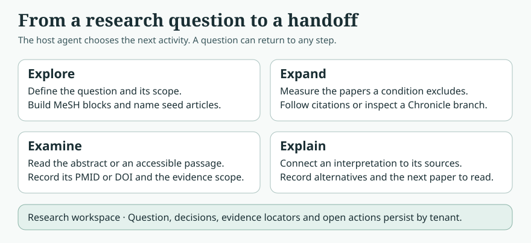

# PubMed Search MCP

<!-- mcp-name: io.github.u9401066/pubmed-search-mcp -->

[繁體中文](README.zh-TW.md) · [Documentation site](https://u9401066.github.io/pubmed-search-mcp/) · [Release history](CHANGELOG.md)

An agent plugin for biomedical literature research. The host agent chooses a search strategy, follows citations and records what it read. The MCP server queries providers and keeps identifiers, search runs and evidence artifacts. A colleague using the same research workspace can pick up the outstanding reading.



## Quick install

| Choose a version | Start here |
| --- | --- |
| Published v0.9.0 | Configure the client's stdio command as `uvx`, with `pubmed-search-mcp@0.9.0` as its argument. Set `NCBI_EMAIL` to your research contact. The release registry contains 41 entries. |
| Team preview on `feature/research-workspace` | Build the plugin from this checkout with the command below. This branch exposes **42 MCP Tools** and adds a persistent research workspace and a Boolean comparison mode for PubMed. |

```sh
uv run --frozen python scripts/build_agent_plugin.py --dev-output build/pubmed-research-plugin
```

Select the generated directory in your agent's plugin installer. Keep the checkout available. The generated launcher uses this source tree. The version-pinned launcher in `plugins/pubmed-search/` uses the published package. [Client configurations and plugin installation](docs/guides/INTEGRATIONS.md)

## Start with a research question

For example, ask the agent to trace the early development of cochlear implants and leave the next paper to read for a colleague. Choose a workflow before memorizing 42 tool names.

| Research task | What the agent can do |
| --- | --- |
| Define the scope | Expand MeSH and synonyms, validate agent-supplied PICO, or compare which papers a Boolean condition excludes. [PubMed combination example](docs/guides/TOOLS_USAGE_GUIDE.md#compare-pubmed-concept-blocks) |
| Search and extend | Search several providers, inspect per-source failures, then follow related papers, references or citing articles. [User guide](docs/guides/USER_GUIDE.md) |
| Read and verify | Inspect an abstract, an available full-text passage, figures or bibliography matches. Use `diagnose_institutional_access` for a configured resolver. Record the source and what was actually read. [Tool guide](docs/guides/TOOLS_USAGE_GUIDE.md) |
| Reuse a review strategy | Save a PICO or citation-expansion pipeline, run it again and inspect its history. Eligibility screening and statistical pooling remain researcher tasks. [Pipeline tutorial](docs/guides/PIPELINE_MODE_TUTORIAL.en.md) |
| Explore research history | Review dated Chronicle branches, landmarks, earlier alternatives and revision differences. [Historical case and workspace handoff](docs/guides/ADVANCED_RESEARCH_WORKFLOWS.md) |
| Share results | Export citations or notes, record source identifiers and leave an open action. The host can cross-check an authorized local Zotero library. [Capability inventory and evidence](docs/README.md#capability-inventory) |

For each of the 16 registry categories, see the implementation evidence and remaining limits in the [inventory](docs/README.md#capability-inventory). The [tool-by-tool audit](docs/research/TOOL_QUALITY_AUDIT.md) and [generated index](src/pubmed_search/presentation/mcp_server/TOOLS_INDEX.md) give individual contracts.

## Search limits and recovery

Generic literature discovery uses exactly one MCP entry point, `unified_search`. A source's result budget is divided across that source's query strategies. Inspect `search_status` and the run artifact before interpreting a small or empty result. OA identifiers, authorized institutional access and local copies determine which full-text passages can be read.

The `search-run/v1` journal also covers inline, `saved:<name>`, or `dry_run=true` pipeline execution. Use `read_session(request={"action":"replay_search","run_id":"..."})` to recover the original credential-free arguments. There is no public cursor-resume parameter yet. Submitting the recovered request starts a new search. A reply with `search_run.status="history_unavailable"` has no guaranteed durable replay. [Recovery and artifact formats](docs/guides/TOOLS_USAGE_GUIDE.md)

## Configuration

| Runtime | State and access |
| --- | --- |
| stdio or loopback HTTP | Trusted single-user deployment with a durable `default` tenant. The HTTP entry point is `pubmed-search-mcp-http --mode local --host 127.0.0.1`. |
| Authenticated service | `--mode service` fails closed without a bearer principal. Authenticated callers cannot load `file:` pipelines or choose a server-host note path. The service Compose scheduler is disabled. [Deployment](DEPLOYMENT.md) |
| Copilot Studio | Set `PUBMED_AUTH_TOKENS` and an assigned `NGROK_DOMAIN` before using `scripts/start-copilot-studio.sh --with-ngrok`. The local smoke launcher exercises the same canonical 42-tool strict registry. [Copilot integration](copilot-studio/README.md) |

Modern 2026-07-28 clients use MCP SDK v2 requests. Python applications can call `pubmed_search.api` directly. The optional `pubmed-browser-fetch-broker` runs on a machine with an authorized browser session. [Integration guide](docs/guides/INTEGRATIONS.md) · [Python facade](docs/design/PYTHON_SDK_AND_HTTP_CLI_DESIGN.md)

## Skills and development

**Usage Skills (12)** are shipped with the branch plugin. **Development Skills (15)** stay in the repository for contributors. [Plugin skills](plugins/pubmed-search/skills/) · [Architecture](ARCHITECTURE.md) · [Testing](docs/development/TESTING.md) · [Contributing](CONTRIBUTING.md)

## Citation and license

Cite the software version used, and the commit for a branch experiment. Cite original papers for research claims. The manuscript is a working draft. [Software citation](CITATION.cff) · [Manuscript and evaluation](docs/publication/README.md) · [Apache License 2.0](LICENSE)
