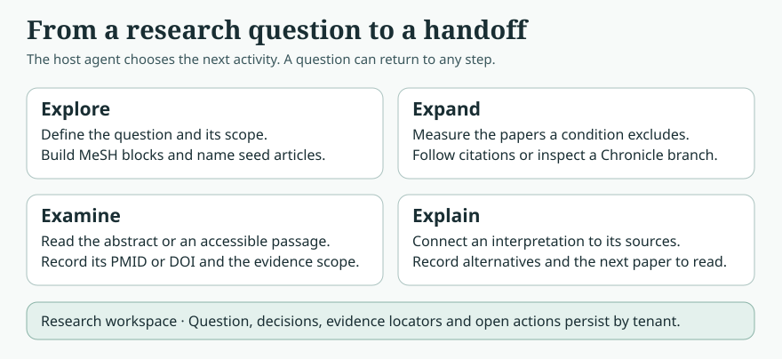

# PubMed Search MCP

[English](README.md) · [文件網站](https://u9401066.github.io/pubmed-search-mcp/) · [版本紀錄](CHANGELOG.md)

供 agent 探索與管理生醫文獻的研究外掛。Agent 決定搜尋範疇、追查引文並解讀證據。MCP server 查詢各資料來源，保存篇目、檢索紀錄和讀過的材料。同事可在相同研究工作區接手尚待查證的問題。

PubMed 搜尋程式可追溯至 2025 年 11 月 25 日的 `med-paper-assistant`。GitHub 記錄本獨立倉庫於 2025 年 12 月 2 日建立，12 月 8 日首次上傳 PyPI。[專案沿革與原始紀錄](docs/publication/README.md#project-history)



## 快速安裝

| 使用情境 | 安裝方式 |
| --- | --- |
| 正式版 v0.10.0 | 在 client 設定 stdio 指令 `uvx`、引數 `pubmed-search-mcp@0.10.0`，並用 `NCBI_EMAIL` 設定學術聯絡信箱。此版提供 **43 個 MCP 工具**，包含持久研究工作區。 |
| 開發工作區 | 在 checkout 執行下方指令，以安裝可測試本機變更的 plugin。 |

```sh
uv run --frozen python scripts/build_agent_plugin.py --dev-output build/pubmed-research-plugin
```

在 agent 的 plugin 安裝介面選擇產生的目錄，並保留原始 checkout。這個 launcher 會執行分支程式碼。倉庫內 `plugins/pubmed-search/` 的固定版本 launcher 會執行正式版。[各 client 安裝與設定](docs/guides/INTEGRATIONS.md)

四個回顧主題的盲測記錄了 agent 看過 MeSH 預查後的選擇、找回的已知納入篇目與新增待篩筆數。[方法與逐題結果](docs/reports/mesh-preflight-2017/README.md)

## 從研究問題開始

可請 agent「追查早期人工耳蝸的技術分歧，並留下一篇讓同事接手閱讀的文章」。要理解這 43 個工具，可以先選研究任務。

| 研究任務 | 可以取得的結果 |
| --- | --- |
| 定義範疇 | 擴展 MeSH 與同義詞，驗證 agent 提出的 PICO，實測哪個布林條件排除了哪些篇目。[組合預查範例](docs/guides/TOOLS_USAGE_GUIDE.zh-TW.md#比較-pubmed-概念組合) |
| 搜尋與追索 | 跨來源搜尋，檢查各來源失敗或截斷的情形，再追查相關文獻、參考文獻及後續引用。[使用者指南](docs/guides/USER_GUIDE.zh-TW.md) |
| 閱讀與核對 | 檢視摘要、可取得的全文段落、圖表或書目比對。可用 `diagnose_institutional_access` 診斷已設定的機構存取。[工具指南](docs/guides/TOOLS_USAGE_GUIDE.zh-TW.md) |
| 重用回顧策略 | 保存 PICO 或引文擴展 pipeline，再次執行並比較歷史。研究團隊負責適格性篩選與統計合併。[Pipeline 教學](docs/guides/PIPELINE_MODE_TUTORIAL.md) |
| 追溯研究史 | 從 Chronicle 查閱分支、關鍵文章、早期替代解釋與版次差異。[歷史案例與研究交接](docs/guides/ADVANCED_RESEARCH_WORKFLOWS.zh-TW.md) |
| 交付研究 | 匯出引文或筆記、記錄來源與待辦。Host 可另用獲授權的 Zotero 本機書庫比對。[功能與驗證證據](docs/README.md#capability-inventory) |

[功能盤點](docs/README.md#capability-inventory)列出 16 個 registry 類別的證據與限制。[逐工具稽核](docs/research/TOOL_QUALITY_AUDIT.zh-TW.md)和[工具索引](src/pubmed_search/presentation/mcp_server/TOOLS_INDEX.md)可查各工具契約。

## 搜尋邊界與可回復的 search runs

一般文獻發現對外固定只有一個 MCP tool，入口是 `unified_search`。Deep search 採精準優先：原始查詢先取得每個來源的**完整 limit**，不足時才由較低精準度策略補足剩餘名額，並在 `broadening` 揭露。解讀零筆或少量結果前，先看 `search_status` 和來源紀錄。全文是否可讀取取決於公開識別碼、機構授權與可用的本機文件。

`search-run/v1` 保留檢索紀錄。`replay_search` 只回傳原本、已移除 credential 的參數。重新提交會開始一次有界搜尋，目前沒有對外的 provider cursor 續傳參數。遇到 `history_unavailable` 時，該次搜尋沒有可保證復原的紀錄。[恢復流程與 artifact](docs/guides/TOOLS_USAGE_GUIDE.zh-TW.md)

## 設定方式

| 部署方式 | 狀態與權限 |
| --- | --- |
| stdio 或本機 HTTP | 可信單使用者使用 durable `default` tenant。本機 HTTP 指令為 `pubmed-search-mcp-http --mode local --host 127.0.0.1`。 |
| 認證多人服務 | `--mode service` 在缺少 bearer principal 時 fail closed。服務呼叫者不能載入 `file:` pipeline 或自訂主機筆記路徑。service Compose 預設停用排程。[部署指南](DEPLOYMENT.md) |
| Copilot Studio | 配置 `PUBMED_AUTH_TOKENS` 與指定的 `NGROK_DOMAIN`，再執行 `scripts/start-copilot-studio.sh --with-ngrok`。[Copilot 整合](copilot-studio/README.md) |

現代 2026-07-28 client 使用 MCP SDK v2 請求。Python 呼叫端可直接使用 `pubmed_search.api`。需要使用已授權瀏覽器 session 時，可另啟動 `pubmed-browser-fetch-broker`。[整合指南](docs/guides/INTEGRATIONS.md) · [Python 介面](docs/design/PYTHON_SDK_AND_HTTP_CLI_DESIGN.md)

## Skills 與開發

**使用 Skills (12)** 隨正式版 plugin 提供。**開發 Skills (15)** 留在倉庫供貢獻者使用。[Plugin skills](plugins/pubmed-search/skills/) · [架構](ARCHITECTURE.md) · [測試政策](docs/development/TESTING.md) · [貢獻指南](CONTRIBUTING.md)

## 引用與授權

歡迎貢獻程式、可重跑的檢索案例、附史料的 Chronicle 修正或文件翻譯。回報時請附版本或 commit，寫出下一位讀者能重現的觀察。[協作指南](CONTRIBUTING.md) · [GitHub Issues](https://github.com/u9401066/pubmed-search-mcp/issues)

軟體採 Apache License 2.0。再散布時請附上授權文本，保留適用的聲明，並標示修改過的檔案。透過工具取得的論文、圖片與資料集各自適用來源的授權條款。[授權全文](LICENSE)

請引用實際使用的軟體版本。分支實驗加註 commit，研究主張回引原始文獻。方法論文目前為工作稿。[軟體引用](CITATION.cff) · [研究稿與評估](docs/publication/README.md) · [Apache License 2.0](LICENSE)
