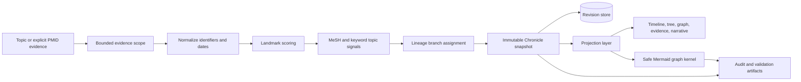
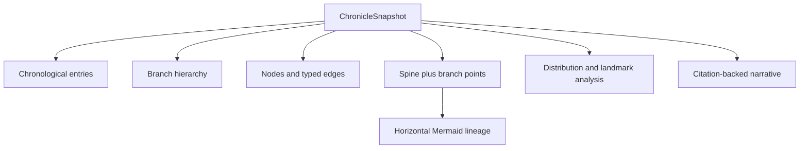
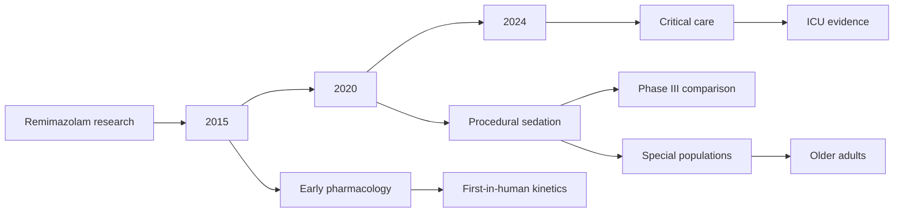
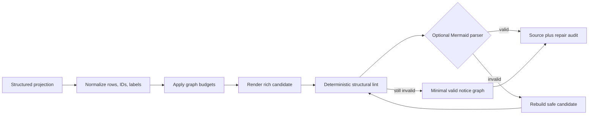

# Research Chronicle architecture and contract

> Status: implemented canonical architecture
> Contract generation: v3 (strict, breaking)
> Last reviewed: 2026-11-25

Research Chronicle is an evidence-backed, revisioned view of how a research
topic developed. Its defining visualization is not a flat publication list and
not a free-form mind map. It is a horizontal chronological spine with semantic
branches attached at their earliest supported year.

## Product claim and limits

The feature supports the claim that the server reconstructed an auditable
chronicle from the evidence it retrieved. It does not claim that missing papers
never existed, that a branch has ended, or that citation count alone proves
historical importance.

Every saved revision therefore retains:

- the exact evidence scope and bounded retrieval diagnostics;
- a deterministic chronological ordering;
- topic-signal or explicitly disclosed fallback branch assignment;
- branch points, milestones, provenance, omissions, and limitations;
- multiple projections generated from one immutable snapshot;
- Mermaid source plus validation, repair, fallback, and omission metadata.

Topic retrieval also records ranking provenance rather than inferring it from
the requested option. `ranking_requested` preserves caller intent, while
`ranking` names only the ordering that actually ran. The Chronicle may claim
`icite_citation_count_then_pubmed_relevance` only when at least one validated
iCite `citation_count` was applied; otherwise the effective ranking remains
`pubmed_relevance`.

The `citation-metrics-coverage/v1` envelope distinguishes `complete`,
`partial`, `empty`, `error`, and `not_requested`, with requested, returned,
applied, and sortable-count totals. Provider and response-validation failures
are retained as allowlisted, query-safe diagnostics. The audit warns on
outage, empty or partial coverage and fails contradictory ranking claims, so a
requested enrichment can never be mistaken for a completed one.

Explicit-PMID builds request the same validated iCite metrics in one batched,
cached call and record the same envelope under
`timeline_metadata.retrieval.citation_metrics`, with
`evidence_selection="explicit_pmid_set_without_ranking"`: the requested set is
never re-ranked or truncated, so it makes no ranking claim. Validated metrics
feed landmark scores and citation-threshold milestones. When iCite returns no
usable row, no landmark composite is computed; ranking falls back to stored
citation counts and then chronology, and both the audit and the summary say
so.

## Evidence labels and extractive highlights

Each entry records `provenance.study_design` (`study-design-label/v1`). PubMed
`PublicationType` is the primary source (Randomized Controlled Trial, Clinical
Trial, Meta-Analysis, Systematic Review, Guideline, Consensus Statement,
Observational Study, Case Report, Review and others), refined by MeSH
study-design descriptors such as `Prospective Studies`; `X as Topic`
descriptors describe what a paper is about and are never used. Only when
indexing states no design may a title or a self-describing abstract phrase
supply one, with `basis="text_pattern_heuristic"` and a `[heuristic]` display
marker; a `Review` type may be refined from its title to a systematic review.
"Non-randomized" and "quasi-randomised" studies are never labelled RCTs. A
protocol (`Clinical Trial Protocol`, even alongside `Randomized Controlled
Trial`, or a "Protocol for a randomised trial" title) is labelled a protocol,
and errata, retraction notices and expressions of concern are publication
notices; neither reports results, so neither becomes a milestone or carries
an evidence level. Retracted publications are flagged. The entry title and
`EvidenceArticle.article_type` use this label, and `entry_label_basis` records
where it came from.

Indexed publication types outrank text-pattern milestone heuristics. A title
or abstract pattern may add what the type vocabulary lacks, such as a trial
phase, but cannot relabel an indexed trial or synthesis as a safety alert,
approval, debate or breakthrough. An observational or generic (comparative,
multicenter) study may still carry a trial phase or an explicit safety signal,
as before indexed designs were consulted. MeSH design descriptors refine labels
but never veto a text milestone, so a MeSH-only design cannot remove a paper
from a capped topic timeline. Abstract patterns match only self-describing
design phrases ("In this phase 3 trial", "We performed a meta-analysis", "A
meta-analysis of 12 trials was performed"), never sentences about other work
("A recent meta-analysis suggested..."), and only within the categories an
indexed design is compatible with. A safety alert requires an explicit safety
communication, safety signal or boxed warning, not a mention of adverse
events. The `study_design_labels` audit lists heuristic labels and
abstract-derived categories (`abstract_pattern_categories`) and warns on a
safety or debate category attached to an incompatible indexed research design.

`provenance.extractive_highlight` (`chronicle-extractive-highlight/v1`) quotes
one sentence of the paper's own abstract: the first substantive sentence of a
structured CONCLUSIONS section, else the last RESULTS sentence, else a
conclusion-cue or final sentence. Registration, funding, competing-interest,
licence and publisher text is never quoted, and sentence splitting keeps
abbreviations such as "(e.g.", "vs.", "et al." and "Fig." inside the sentence.
When an abstract is known to be incomplete (a PubMed `ABSTRACT TRUNCATED`
notice, or only the first 20,000 characters stored), the notice and the cut
fragment are never quoted, `provenance.abstract_truncation` and the
highlight's `abstract_truncated` record it, and the `extractive_highlights`
audit warns. `char_start` and `char_end` are Unicode code-point offsets into
`EvidenceArticle.abstract`, pinned by `abstract_sha256` and length, so
`abstract[char_start:char_end] == text` can be checked from the snapshot alone.
The summary claim, the summary highlights and the narrative quote this text and
label it extractive; it is not an interpretation. Entries without an abstract
keep the conservative template claim. The `extractive_highlights` audit fails
when any quote does not round-trip. Diffs reduce stored abstracts to a digest
and a length.

Lineage excludes descriptors that restate the topic before it selects
branches: terms whose content words or multi-word acronym already occur in the
topic query, terms present in every entry, and, once a revision has at least
eight entries, descriptors on at least half of them whose co-occurrence with
the other recurring descriptors is at least 0.8 of their base rate (they cut
across lines instead of separating them).
`lineage_diagnostics.excluded_topic_signals` records each exclusion with its
share and reason. Branch signals are then chosen greedily by the
inverse-frequency weight of the papers they newly cover
(`signal_selection="greedy_marginal_coverage"`, MeSH winning ties), so every
line starts with at least two papers that no earlier line claimed, and
`cross_signal_links` keep the remaining multi-signal matches explicit.
Insufficient discriminative signal still produces the warned research-stage
fallback.

## Canonical MCP surface

Only two public tools exist:

- `build_research_chronicle`: retrieve or accept PMID evidence, assemble one
  snapshot, persist a new revision, and return one projection;
- `read_research_chronicle`: perform one strict read operation over stored
  revisions.

There are no timeline aliases, mind-map outputs, flat action arguments, or
compatibility wrappers.

### Build examples

```python
build_research_chronicle(
    topic="remimazolam sedation",
    max_events=80,
    output="mermaid",
)

build_research_chronicle(
    topic="remimazolam sedation",
    pmids="last",
    output="chronicle_map",
)
```

The accepted outputs are `summary`, `json`, `chronicle_map`, `timeline`,
`tree`, `graph`, `evidence`, `milestones`, `mermaid`, and `narrative`.
`mermaid` is the sole Mermaid mode and always uses the chronology-plus-branches
semantics described below.

### Strict read request

`read_research_chronicle` accepts exactly one discriminated `request` object.
Each action has its own schema and rejects fields belonging to another action.

```python
read_research_chronicle(request={"action": "list", "limit": 20})

read_research_chronicle(request={
    "action": "load",
    "chronicle_id": "remimazolam-9f2b1c4d",
    "output": "mermaid",
})

read_research_chronicle(request={
    "action": "diff",
    "chronicle_id": "remimazolam-9f2b1c4d",
    "from_revision": 1,
    "to_revision": 2,
})

read_research_chronicle(request={
    "action": "compare",
    "selection": {
        "kind": "topics",
        "values": ["remimazolam", "propofol"],
    },
})
```

The six actions are `load`, `list`, `diff`, `narrate`, `milestones`, and
`compare`. Compare selection is itself discriminated as `topics` or
`chronicle_ids`; comma-separated pseudo-arrays are rejected.

### Recording a newly recognized historical connection

The record includes changes in classification of papers already present.
Publication year describes the paper. The revision pair identifies when the
change was observed in this comparison. Summaries and any downstream alert
budget are views over the record. An agent can read every observed entry in a
revision with `load` and `output="timeline"`, or inspect previous revisions
when retrieval coverage has changed.

For each newly observed branch, `diff` returns
`branches.added_details[].evidence_observation`. Its `previously_observed` and
`newly_observed` lists carry evidence IDs and nullable publication years.
An evidence ID receives a year when all its dated occurrences in `to_revision`
agree. If every occurrence lacks a year or the recorded years disagree, its
`publication_year` is `null`. The comparison uses direct branch members and looks for their evidence anywhere
in the earlier revision. The `basis` is `previously_observed_only`,
`newly_observed_only`, `mixed`, or `undetermined` for insufficient membership
information. Review scope changes, coverage and the actual metadata differences
before attributing a cause. A paper absent in the earlier revision may itself
be decades old or have appeared in another revision.

### Finding retrievable text and working through source outages

Use `load` with `output="evidence"` to resolve an entry to the specific articles
that back it. Each row includes `fulltext_lookup_source`, a validated source
object for `get_fulltext(source=..., output_format="json")` when an identifier
is available. In `fulltext_coverage`, `total_evidence_ids` counts distinct
evidence IDs in **this revision**. Of those, `with_stored_artifact_uri` counts
IDs with a nonblank full-text artifact URI on at least one occurrence.
Reading this projection uses the snapshot alone. A link still requires a read and a passage check.
An empty link field leaves open the possibility of an accessible copy elsewhere.

Run supplemental discovery in the intended corpus. Europe PMC supports section
queries for indexed text. An agent with Zotero Keeper can independently search
a permitted library and its indexed attachments, reconcile exact identifiers,
and read a specific attachment. Keep paper date, discovery source, identifier,
and verified passage or access gap with the result. Explicit Chronicle builds
currently take PMIDs and fetch their PubMed records. Preserve local-only
references without PMIDs alongside the Chronicle for later reconciliation.
For a failed refresh, `read_research_chronicle` can read a stored revision
without making a provider request. Record its revision number when citing it.

### Investigating a historical fork

In `chronicle_map`, `branch_point_semantics` identifies the layout anchor as
the earliest dated entry in a branch or its descendants. A separate
`divergence_review` describes an indexing pattern in one revision. For each
pair of selected topics, a candidate has a dated `shared_paper` tagged with
both topics and two distinct `later_papers`, each matching only one selected
topic. Publication-date intervals must establish the order. The projection
keeps one deterministic example per pair. `earlier_single_signal_papers`
can expose an alternative reading in which the separate lines already
existed. Each witness carries its entry ID, evidence ID and recorded date.
The agent must read contemporary material to establish what was compared,
whether there was disagreement, and which researchers subsequently adopted an idea.
If a stored map exceeds the lineage builder's six-topic limit, the review
reports `topic_branch_limit_exceeded` and the observed and supported counts.
The branch rows remain available for inspection.

Even if a revision has insufficient signal provenance, `sources_for_review`
lists entries indexed as comparative studies or consensus documents. Each
lists the matched publication types and supporting evidence IDs. A consensus
document can establish what was debated on a given date once its wording is
checked. A meeting and the publication of its proceedings can have different dates.

The map reports `direct_activity` per branch. Each observed year gives
`branch_entries` and `all_revision_entries`. The denominator includes entries
with unresolved ownership. Descendants and secondary topic matches make no
additional contribution to the numerator. Undated entries are counted separately.
These counts describe visibility in a bounded set. Historical adoption requires
dated evidence about a specified community, practice or institution.

In `milestones`, the global landmark shortlist includes recorded
`score_components` where available. `observed_max_citations` preserves
uncertainty when the available snapshot cannot establish a count.
Citation coverage, maximum and median count each evidence ID once, using
its highest observed count in this revision. A zero requires an observation
attributable to that paper. The maximum and median are null if all counts are missing.
`branch_representatives` gives a reading entry point for each branch with
reliable direct members, including branches absent from the global shortlist.
Inspect the selection basis before treating an entry as historically consequential.

## Data flow



Presentation tools validate input and format the response. Search, scoring,
assembly, differencing, narration, projection, persistence, and visualization
logic remain in the application/domain layers.

## One snapshot, several projections

The stored snapshot is authoritative. `timeline`, `tree`, `graph`,
`chronicle_map`, `milestones`, `narrative`, and `mermaid` are projections; none
may rebuild or reorder evidence independently.



The ordering key is deterministic and places known publication dates before
year-only and unknown-date records without inventing a date. Stable
identifier-based tie-breakers prevent a new revision from reshuffling equal
dates arbitrarily.

## Horizontal timeline with thematic branching

The Mermaid projection uses `flowchart LR`:

1. the topic root connects to ascending year anchors;
2. each branch attaches to the earliest supported year anchor;
3. child branches retain both their own evidence-backed year anchor and a
   separate lineage edge from their validated parent branch;
4. papers appear in chronological order within the branch;
5. branch and event labels are short visual summaries; full evidence remains
   in structured artifacts.



A branch is evidence-supported when multiple semantic signals overlap. If
coverage is insufficient, the assembler may use a research-stage fallback,
but the snapshot and summary must label that basis explicitly. A visual branch
must not imply a causal or citation relationship unless the corresponding edge
exists in structured evidence.

## Mermaid correctness pipeline

Mermaid generation is a fault-contained pipeline shared by Chronicle and other
graph-producing features:



Automatic repair covers:

- stable identifier generation and collision separation;
- control, bidi, zero-width, newline, directive, comment, Markdown fence, and
  delimiter neutralization in untrusted labels;
- empty-label defaults and byte-aware truncation;
- invalid roles, parent identifiers, years, endpoints, self edges, duplicate
  edges, duplicate entry identifiers, and branch cycles;
- malformed projection collections and rows;
- bounded years, branches, events, graph nodes, graph edges, source characters,
  and source bytes;
- rich-to-safe-to-minimal fallback when validation rejects a candidate.

The result includes `mermaid-validation/v1` metadata: tier, status, source
digest and size, structural/parser validation flags, correction counts,
omission counts, warnings, and validator identity. A fallback is therefore
visible and auditable rather than silently presented as the complete graph.

Runtime use does not require Node.js. CI and release verification additionally
render exported smoke fixtures with the pinned Mermaid parser so deterministic
lint and real parser behavior are both covered.

## Revision and diff semantics

Each build creates a new revision only after a complete snapshot is assembled.
Diff output reports added, removed-from-observation, changed, and stable entries
within the two captured scopes. An entry absent from a later bounded retrieval
is `not_observed_in_revision`; it is not conclusively retired.

Branch identity derives from canonical topic signals rather than display text,
so a label change does not automatically invent a new branch. Scope changes,
coverage changes, fallback mode, and partial retrieval are explicit diff/audit
inputs.

## Failure and persistence boundaries

- Invalid tool input fails before search or storage mutation.
- Durable Chronicle operations are denied when the runtime has no safe tenant
  storage boundary.
- Snapshot publication is revisioned and atomic at the store boundary.
- Artifact persistence failure is reported separately; it does not corrupt a
  successfully stored Chronicle revision.
- Malformed visual data never aborts Chronicle creation; it produces a bounded
  fallback diagram and diagnostics.
- Machine-readable projections retain JSON error responses; Markdown modes use
  human-readable errors without leaking local paths or upstream bodies.

## Verification matrix

The release gate covers:

- chronological determinism and unknown-date ordering;
- semantic branch assignment, branch points, parent validation, and fallback
  disclosure;
- requested-versus-effective ranking, iCite response validation, partial/empty/
  outage coverage in topic and explicit-PMID modes, and contradictory
  provenance claims;
- PubMed-first study-design labels, disclosed heuristics, no text-pattern
  safety category on indexed trials or syntheses, protocols and notices kept
  out of milestones, milestones master emitted for observational and MeSH-only
  designs, self-describing abstract patterns, and verified extractive
  highlight offsets that never quote boilerplate or truncated text;
- exclusion of topic-restating descriptors from branch formation;
- revision integrity, scope-aware diffing, narration, milestones, and compare;
- strict discriminated request schemas and rejection of legacy shapes;
- adversarial Mermaid labels, malformed projections, cycles, duplicate IDs,
  size budgets, all fallback tiers, and parser fixtures;
- documentation examples and generated site synchronization;
- full pytest, Ruff, mypy, async-test audit, and real Mermaid rendering.

This contract intentionally prefers an explicit failure or disclosed fallback
over a diagram that looks plausible but cannot be traced to the stored evidence.
