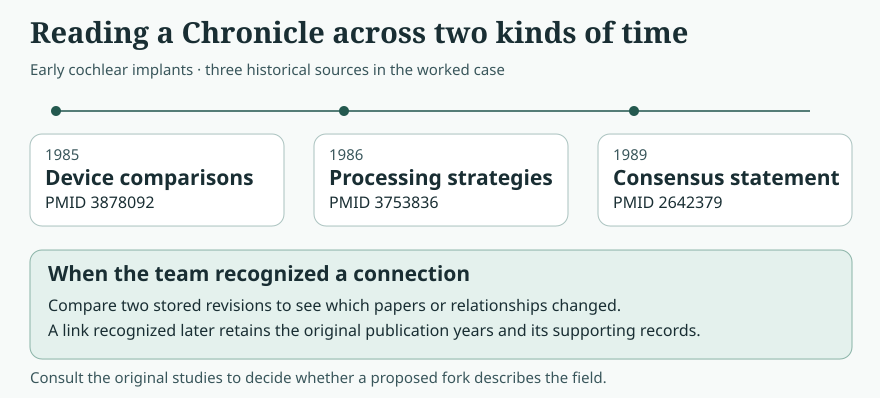
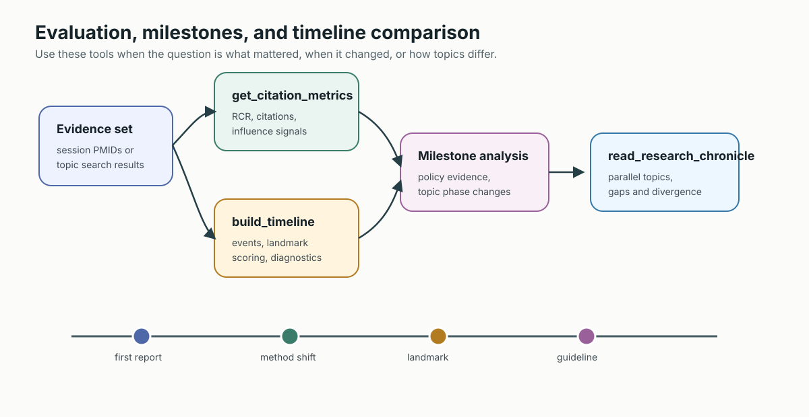

# Advanced Research Workflows

This page provides a centralized, in-depth guide to the core advanced workflows
in PubMed Search MCP: **Research Chronicle (Evolution & Lineage Trees)**,
**Open-i Image Search**, **Uploaded-Image Handoff**, and **Persistent Query Memory**.

## Quick Map

| Need | Start here | Continue with |
| --- | --- | --- |
| Investigate dated papers on the main and alternative lines of a topic | `build_research_chronicle` | `read_research_chronicle` |
| Find biomedical images from text (X-ray, histology, CT) | `search_biomedical_images` | `get_article_figures`, `unified_search` |
| Upload or pass an image and search by its visual meaning | `prepare_figure_search` | `search_biomedical_images`, `unified_search` |
| Re-open large search/fulltext outputs without rerunning | `read_session(request={"action":"artifact","locator":{"kind":"artifact_id","value":"..."}})` | `read_session(request={"action":"list_artifacts"})` |

---

## Research Chronicle / Lineage Tree



### 1. Core Principles & Epistemic Model

A Chronicle preserves the papers retrieved for a topic or a set of PMIDs, their publication dates and their topic assignments. Each projection uses the same immutable revision. Research Chronicle is the only research-lineage capability. `unified_search` provides a starting set of evidence.

### Investigate a possible research fork

```python
build_research_chronicle(topic="Cochlear implants",
                         pmids=["3878092", "3753836", "2642379"], output="chronicle_map")
```

1. **Read the contemporary evidence.** The 1985 paper compares devices. The 1986 paper compares processing strategies on the same implant. The NIH conference took place in 1988 and the journal version of its statement appeared in 1989. In the worked example, the revision had insufficient topic-signal provenance for a fork. Its `sources_for_review` still identified both comparative studies and the consensus statement for reading. The original statement documents that choosing between device types was debated in 1988. [Case and source documents](../reports/chronicle_historical_method_2026-11-20.md)
2. **Inspect both explanations.** `branch_point` anchors the diagram at the earliest dated entry in a branch or its descendants. For each pair in `divergence_review.candidates`, read the shared paper and both later papers. An earlier single-signal paper may show that a line was already active. Use the authors' methods, disagreement or documented adoption to establish the historical interpretation.
3. **Report what was counted.** `direct_activity.by_year` compares direct branch entries with all entries in that year of the revision. To assess adoption across hospitals or research groups, find a dated survey or registry with the appropriate denominator. The milestone view supplies a global shortlist and a representative from each branch with attributable evidence. Check `score_components`, `observed_max_citations` and the representative's `selection_basis`.
4. **Cite what you could verify.** The `evidence` view supplies `fulltext_lookup_source` for a subsequent `get_fulltext` call. `fulltext_coverage` counts saved artifact links. Record the actual section, page or table once read. When available, supplement public search with a Europe PMC section query or an authorized Zotero Keeper attachment. Match records by PMID or DOI and retain DOI-only library records beside the Chronicle until a PMID is confirmed.

A rebuild can reveal a newly recognized link between papers already present. In the `diff` view, each added branch's `evidence_observation` lists the previously and newly observed IDs with their publication years. This dates the observation relative to the two selected revisions. The audit records the bounds on retrieval and each revision preserves its own evidence.



---

### 2. Dual Tool Facades & Output Modes

#### 🛠️ `build_research_chronicle` — Create or Continue a Chronicle

```python
# 1. Build from topic (retrieves PubMed, scores landmarks, clusters lineages)
build_research_chronicle(topic="remimazolam intraoperative", max_events=30)

# 2. Build from previous search results or explicit PMIDs
build_research_chronicle(pmids="last", topic="My Reading List")
build_research_chronicle(pmids="32417976,34999964,36712948", topic="Selected Studies")

# 3. Continue an existing chronicle (inherits stored topic and filters to produce Revision N+1)
build_research_chronicle(chronicle_id="remimazolam-intraoperative-08c229f3")
```

#### 📖 `read_research_chronicle` — Read, Diff, and Analyze Stored Evidence

| Action | Purpose | Example |
| --- | --- | --- |
| `load` | Load a stored revision in any format (defaults to latest) | `read_research_chronicle(request={"action":"load","chronicle_id":"...","output":"mermaid"})` |
| `list` | List all persisted chronicles with latest revision IDs | `read_research_chronicle(request={"action":"list"})` |
| `diff` | Compare two revisions (added, unobserved, role shifts, audit) | `read_research_chronicle(request={"action":"diff","chronicle_id":"...","from_revision":1})` |
| `milestones` | Diagnostic overview of milestone types, years, and landmark scores | `read_research_chronicle(request={"action":"milestones","chronicle_id":"..."})` |
| `compare` | Compare 2–5 topics side-by-side with shared evidence analysis | `read_research_chronicle(request={"action":"compare","selection":{"kind":"topics","values":["remimazolam","propofol"]}})` |
| `narrate` | Render evidence-backed Markdown with citations for writing/reporting | `read_research_chronicle(request={"action":"narrate","chronicle_id":"...","mode":"full"})` |

#### 🎨 10 Supported Output Formats (`output` parameter)

| Output Format | Type | Description |
| --- | :---: | --- |
| `summary` | Markdown | Default compact summary with chronological spine, research lines, and highlights. |
| `mermaid` | Diagram | **Canonical X-Y lineage tree**. Horizontal year spine + branching research lines + article blocks. |
| `chronicle_map` | JSON | Diagram coordinates, dated fork candidates, contemporary sources and annual branch counts. |
| `timeline` | JSON | Chronological projection JSON ordered strictly by publication date. |
| `tree` | JSON | Thematic lineage tree JSON organized into branch and sub-branch hierarchies. |
| `graph` | JSON | Typed provenance graph (Topic → Branch → Entry → EvidenceArticle). |
| `evidence` | JSON | Distinct evidence articles, full-text lookup identifiers and stored-link coverage. |
| `milestones` | JSON | Milestones, recorded ranking inputs and a representative from each eligible branch. |
| `narrative` | Markdown | Academic prose narrative with inline PMID/DOI citations. |
| `json` | JSON | Complete immutable snapshot dictionary. |

---

### 3. Read the dated evidence behind a diagram

The following reading order uses the three records from the cochlear implant example above. The conference date comes from the original statement. The journal record uses its own publication year. [1985 comparison](https://pubmed.ncbi.nlm.nih.gov/3878092/) · [1986 comparison](https://pubmed.ncbi.nlm.nih.gov/3753836/) · [NIH statement](https://files.eric.ed.gov/fulltext/ED350771.pdf) · [1989 journal record](https://pubmed.ncbi.nlm.nih.gov/2642379/)

| Source date | What the reader can check |
| --- | --- |
| 1985 | The authors compared three single-channel and three multichannel devices. |
| 1986 | The authors compared five processing strategies in two subjects using the same type of implant. The same terms now describe a different technical choice. |
| 1988 conference, 1989 journal publication | The NIH statement records disagreement over device choice. Use its introduction and discussion of design tradeoffs when dating that debate. |

To draw the stored revision and then investigate a possible reference, use the ID returned by the build. The citation tree performs a separate lookup of scholarly references and citing papers. Cite a relationship only after checking the source document and which paper it references.

```python
read_research_chronicle(request={"action":"load","chronicle_id":chronicle_id,"output":"mermaid"})
build_citation_tree(pmid="3878092", depth=1, direction="both", output_format="mermaid")
```

For a second topic, build or select its own stored Chronicle. Use its returned ID alongside the first ID in `action="compare"` to inspect their shared evidence and respective coverage. A later rebuild of the same Chronicle can be read with `action="diff"`.

---

## Open-i Biomedical Image Search

Use `search_biomedical_images` when the visual finding is already text and the
goal is image evidence from Open-i.

```python
search_biomedical_images("chest X-ray pneumonia", sources="openi", image_type="x", limit=10)
search_biomedical_images("histology liver fibrosis", sources="openi", image_type="mc", license_type="by")
```

Open-i expects English medical terminology. For non-English prompts, the agent
should first translate anatomy, finding, and modality into English, then call
`search_biomedical_images`. Open-i is strongest for radiology, microscopy,
clinical photos, and teaching images; for article-native figures, use
`get_article_figures` on PMC Open Access articles.

---

## Uploaded Image To Literature Search

`prepare_figure_search` is the handoff tool for images supplied by an MCP
client. It accepts an image URL or a base64/data-URI image and returns MCP
`ImageContent` plus instructions for the LLM agent.

```python
prepare_figure_search(
    source={"kind":"base64","data":"iVBORw0KGgo..."},
    search_type="medical",
)
```

The server does not perform standalone visual diagnosis. The intended workflow
is:

1. The MCP client passes the uploaded image or image URL to `prepare_figure_search`.
2. The LLM agent uses its vision capability to describe the image and extract English biomedical search terms.
3. The agent immediately continues with `search_biomedical_images` for similar biomedical images or `unified_search` for related papers.

---

## Persistent Query Memory

When session persistence is configured, large `unified_search` and
`get_fulltext` outputs can be saved as artifacts. The immediate tool response can
stay compact while the reusable payload remains available for later reads.

```python
read_session(request={"action":"list_artifacts"})
read_session(request={"action":"artifact","locator":{"kind":"artifact_id","value":"..."}})
read_session(request={"action":"artifact","locator":{"kind":"artifact_uri","value":"artifact://..."}})
read_session(request={"action":"artifact","locator":{"kind":"artifact_uri","value":"artifact://..."},"artifact_file":"audit.json"})
read_session(request={"action":"artifact","locator":{"kind":"artifact_uri","value":"artifact://..."},"artifact_file":"results.json","offset":0,"max_chars":200000})
```

Artifacts are query memory, not a second search. Reading them does not rerun
external source calls. Local filesystem paths are redacted by default because
remote clients cannot read server-local paths. Set
`PUBMED_ARTIFACT_INCLUDE_LOCAL_PATHS=true` only for local agents.

For `unified_search`, artifact files are intentionally richer than the immediate
MCP response. Read `audit.json` first for completeness warnings, then
`query_strategy.json` for the executed source/query plan, then `results.json` or
`results.toon` for the full article list. This keeps response tokens small while
leaving enough evidence for repeated agent reads, sandboxed clients, and future
remote artifact backends.

## Verification Status

The current primary 41-tool MCP server exposes these tools directly:

- Research chronicle: `build_research_chronicle`, `read_research_chronicle`
- Image search: `search_biomedical_images`
- Uploaded-image handoff: `prepare_figure_search`
- Query memory: `read_session(request={"action":"artifact","locator":{"kind":"artifact_id","value":"..."}})`

Coverage is guarded by docs alignment tests, tool registry tests, image-search
tests, vision-search tests, timeline tests, and session artifact tests.
