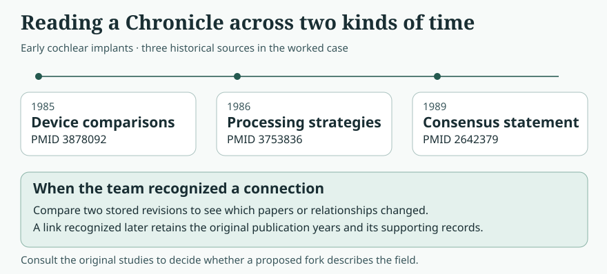
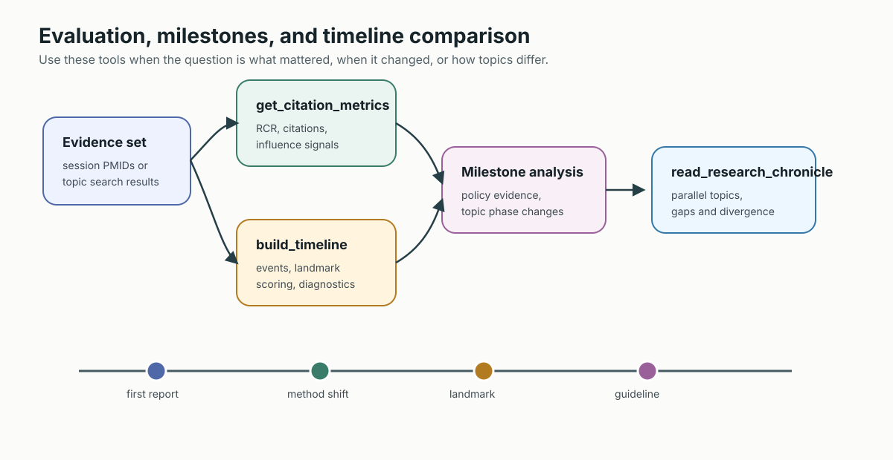

# 進階研究工作流

研究工作區讓一個問題可以跨次接手。想追溯研究歷史可建立編年史，想讀回過去查到的內容可取用 session artifact，需要圖像證據時則可使用圖片工具。

## 快速對照

| 需求 | 從這裡開始 | 接著使用 |
| --- | --- | --- |
| 把問題、查過的依據與待讀文獻交給另一個 agent | 用 `research_workspace` 的 `create` 或 `list` | 用 `record` 留下決定，用 `read` 接手 |
| 追溯主題各條路線的發表時序與分流依據 | `build_research_chronicle` | `read_research_chronicle` |
| 用文字找生物醫學圖片（放射線、病理切片） | `search_biomedical_images` | `get_article_figures`, `unified_search` |
| 上傳圖片，依圖片視覺語意找相關文獻 | `prepare_figure_search` | `search_biomedical_images`, `unified_search` |
| 重新讀取大型搜尋/全文輸出，不重跑外部來源 | `read_session(request={"action":"artifact","locator":{"kind":"artifact_id","value":"..."}})` | `read_session(request={"action":"list_artifacts"})` |

---

## 接續研究工作區

以「早期人工耳蝸研究中的單通道和多通道指的是什麼？」為例。一篇研究比較裝置，另一篇比較訊號處理策略。接手者需要知道兩篇各自在比較什麼，才能判斷是否屬於同一條研究路線。[史學案例與原始文獻](../reports/chronicle_historical_method_2026-11-20.md)

```python
research_workspace(request={"action":"create","workspace_id":"implant-history",
    "question":"早期人工耳蝸研究中的單通道和多通道指的是什麼？"})
```

| 活動 | 這個案例可以怎麼做 |
| --- | --- |
| 探索 Explore | 用 `unified_search` 搜尋，保留查詢字串或已存 pipeline 名稱與篩選條件，找到比較裝置的研究 PMID 3878092，記下篇目來自哪個來源。 |
| 擴展 Expand | 查相關文獻或讀取已存編年史版本，追出比較訊號處理策略的 PMID 3753836。用 `parent_ids` 記錄從哪筆決定延伸出這條線索。 |
| 查證 Examine | 讀兩篇摘要。若裝置研究的方法段仍取不到，記下缺少的細節並保留待辦。可試 `get_fulltext`，或用已獲授權的 Zotero Keeper 依 PMID／DOI 比對館藏。讀到原文後，才以 `fulltext` 記錄實際章節、頁碼或表號。 |
| 解釋 Explain | 連回用以區分裝置與策略的紀錄，引用兩篇原始研究，說明已讀材料能支持的判斷，把未解的方法問題帶入交接摘要。 |

例如讀過第一篇摘要後，可用固定 ID 寫下一筆決定。若在收到回覆前斷線，可用原 ID 與相同內容重送。

```python
research_workspace(request={"action":"record","workspace_id":"implant-history",
    "record_id":"device-comparison","activity":"explore",
    "note":"PubMed 摘要描述裝置間的比較，仍需查核納入裝置的條件。",
    "source_refs":["pmid:3878092"],"evidence_scope":"abstract",
    "next_action":"找出說明如何選取裝置的方法段。"})
```

若工作在此中斷，同一資料儲存位置與租戶下的下一位 agent 可讀回進度。即使文獻來源暫時無法連線，已存紀錄仍可讀取。

```python
research_workspace(request={"action":"read","workspace_id":"implant-history"})
```

若要重新開啟 `pmid:3878092`，可檢查回傳的 `source_handoffs`，將其中的 `arguments` 交給所列工具。讀取工作區本身只會取得已存紀錄。

假設同事在等第一篇全文時，先查了第二篇摘要。以下三筆紀錄可重建他從取得線索到做出有限判讀的過程。

```python
research_workspace(request={"action":"record","workspace_id":"implant-history",
    "record_id":"strategy-lead","activity":"expand","parent_ids":["device-comparison"],
    "source_refs":["pmid:3753836"],"evidence_scope":"metadata",
    "note":"追查 1986 年研究實際比較的對象。",
    "next_action":"閱讀摘要，確認比較的對象。"})
research_workspace(request={"action":"record","workspace_id":"implant-history",
    "record_id":"strategy-abstract","activity":"examine","parent_ids":["strategy-lead"],
    "source_refs":["pmid:3753836"],"evidence_scope":"abstract","resolves":["strategy-lead"],
    "note":"摘要描述在使用同款裝置的兩位受試者身上比較訊號處理策略。"})
research_workspace(request={"action":"record","workspace_id":"implant-history",
    "record_id":"two-comparisons","activity":"explain","parent_ids":["device-comparison","strategy-abstract"],
    "source_refs":["pmid:3878092","pmid:3753836"],"evidence_scope":"abstract",
    "note":"兩篇摘要所稱的通道對應到不同的比較對象。第一篇如何挑選裝置仍待查。"})
```

從 `open_actions` 找回待讀段落。若還有待辦，以 `open_offset=next_open_offset` 翻頁。要從頭看歷程，以 `after=0` 起讀，再依 `next_after` 翻頁。agent 可以回到 Expand 嘗試其他檢索詞或來源。若已獲授權的 Zotero 館藏讓人讀到方法段，新增 Examine 紀錄，保留篇目 ID、實際館藏鍵與段落位置，並用 `resolves=["device-comparison"]` 完成先前待辦。若只查到書目，就保留待辦。每筆紀錄都維持未驗證。交接時給出工作區 ID、判讀所據文獻與尚待查證的問題。

若要交給人閱讀，可將讀取結果存成 UTF-8 JSON，從專案根目錄執行外掛附帶的程式。它會將來源 ID、原文位置、未完成事項與分頁資訊寫到標準輸出。也可直接讀取 MCP 回傳的文字內容封裝。

```sh
uv run --frozen python .claude/skills/pubmed-research-workspace/scripts/render_handoff.py workspace.json
```

---

## 研究編年史 / Research Chronicle



### 1. 核心設計理念與認識論模型

Chronicle 保存該次主題檢索或明列 PMID 取得的文章、發表日期與分類。各種檢視取自同一份不可變版本，可從 `unified_search` 取得起始篇目。

### 如何調查學術分歧

```python
build_research_chronicle(topic="Cochlear implants",
                         pmids=["3878092", "3753836", "2642379"], output="chronicle_map")
```

1. **先讀當年的資料。** 1985 年的論文比較不同裝置，1986 年的論文比較同一裝置上的訊號處理策略。NIH 會議舉辦於 1988 年，聲明的期刊版出版於 1989 年。案例中缺乏足夠標引來產生分流候選，`sources_for_review` 仍列出兩篇比較研究與一篇共識聲明。NIH 聲明原件支持「1988 年當時已有人爭論如何選擇裝置」這項判斷。[實例及原始文件](../reports/chronicle_historical_method_2026-11-20.md)
2. **查核不同解釋。** 圖上的 `branch_point` 標出該線或其子線最早能定年的條目。對每組 `divergence_review.candidates`，檢查跨兩個主題的文章和後來各線的文章，並核對是否早已有獨立文獻。可依當年作者陳述的方法、爭點或採用紀錄來解釋研究何時分流。
3. **說明計數範圍。** `direct_activity.by_year` 提供直接歸屬該線的條目數及整版同年條目數。要主張多數醫院或研究群已採用某種方法，另找當年的調查或登錄分母。`milestones` 同時提供全域候選和各個有可靠證據分支的閱讀代表，可核對 `score_components`、`observed_max_citations` 與代表文獻的 `selection_basis`。
4. **留下可覆核的引用。** `evidence` 的 `fulltext_lookup_source` 可交給 `get_fulltext` 尋找正文。`fulltext_coverage` 統計的是已存的全文連結，實際核讀後再記下段落、頁碼或表號。也可用 Europe PMC 章節索引或獲授權的 Zotero Keeper 館藏補查，以 PMID 或 DOI 核對同篇文獻。只有 DOI 的館藏候選先保留在附表，取得 PMID 後再明列建版。

重建可能辨認出兩篇舊文獻的新關聯。在 `diff` 中，新增分支的 `evidence_observation` 列出比較起點已有及本次新觀察的識別碼與發表年。「新觀察」對應所選的兩版。各版皆保存本身證據與檢索範圍。



---

### 2. 兩大門面工具與輸出格式

#### 🛠️ `build_research_chronicle` — 建立或更新編年史

```python
# 1. 依主題建立（自動檢索 PubMed、計算 Landmark 分數並聚類分支）
build_research_chronicle(topic="remimazolam intraoperative", max_events=30)

# 2. 從既有搜尋結果或自訂 PMID 清單建立
build_research_chronicle(pmids="last", topic="My Reading List")
build_research_chronicle(pmids="32417976,34999964,36712948", topic="Selected Studies")

# 3. 延續既有編年史（自動繼承前版的 topic 與檢索範圍，建立 Revision N+1）
build_research_chronicle(chronicle_id="remimazolam-intraoperative-08c229f3")
```

#### 📖 `read_research_chronicle` — 讀取、比對與深度分析（不重跑搜尋）

| Action | 說明 | 適用情境與範例 |
| --- | --- | --- |
| `load` | 載入特定版本並以指定格式輸出（預設 latest） | `read_research_chronicle(request={"action":"load","chronicle_id":"...","output":"mermaid"})` |
| `list` | 列出已保存的所有編年史清單與最新版本號 | `read_research_chronicle(request={"action":"list"})` |
| `diff` | 比較兩個版本（新增、未觀察到、角色轉變、審計狀態） | `read_research_chronicle(request={"action":"diff","chronicle_id":"...","from_revision":1})` |
| `milestones` | 統計條目分佈、歷年趨勢、證據品質與重大地基論文 | `read_research_chronicle(request={"action":"milestones","chronicle_id":"..."})` |
| `compare` | 橫向比對 2–5 個主題編年史（含共同證據分析） | `read_research_chronicle(request={"action":"compare","selection":{"kind":"topics","values":["remimazolam","propofol"]}})` |
| `narrate` | 輸出帶有完整引用（PMID/DOI）的連貫學術敘事 Markdown | `read_research_chronicle(request={"action":"narrate","chronicle_id":"...","mode":"full"})` |

#### 🎨 支援的 10 種輸出格式 (`output` 參數)

| 輸出格式 | 類型 | 說明與適用場景 |
| --- | :---: | --- |
| `summary` | Markdown | 緊湊摘要（預設）。包含時序主軸、研究分支列表與重大亮點。 |
| `mermaid` | 圖表 | **標準 X-Y 軸演化樹**。橫向年份軸 + 主題分支 + 論文區塊（Mermaid Flowchart LR）。 |
| `chronicle_map` | JSON | 圖形座標、可追溯的分流候選、當代資料及逐年分支計數。 |
| `timeline` | JSON | 時序投影 JSON，依時間嚴格排列。 |
| `tree` | JSON | 樹狀分支投影 JSON，依主題與子主題層級組織。 |
| `graph` | JSON | 型別化 Provenance Graph（Topic → Branch → Entry → EvidenceArticle）。 |
| `evidence` | JSON | 去重後的證據文獻、全文查找識別碼及已存連結涵蓋量。 |
| `milestones` | JSON | 里程碑統計、已記錄的排序依據及各個有可靠證據分支的閱讀代表。 |
| `narrative` | Markdown | 具學術引用的結構化敘事文字。 |
| `json` | JSON | 包含所有欄位與原始資料的完整快照（Snapshot）。 |

---

### 3. 從圖回到當年的文獻

以人工耳蝸案例的三筆資料為例。查考會議用原始聲明的日期，引用期刊紀錄用該篇的出版年。[1985 年研究](https://pubmed.ncbi.nlm.nih.gov/3878092/) · [1986 年研究](https://pubmed.ncbi.nlm.nih.gov/3753836/) · [NIH 聲明原件](https://files.eric.ed.gov/fulltext/ED350771.pdf) · [1989 年期刊紀錄](https://pubmed.ncbi.nlm.nih.gov/2642379/)

| 文件日期 | 能從史料查核的內容 |
| --- | --- |
| 1985 年 | 作者比較單通道和多通道裝置各三種。 |
| 1986 年 | 作者在兩位受試者的同款植入裝置上比較五種訊號處理策略。兩篇都談單、多通道，實際比較的技術選擇不同。 |
| 1988 年會議、1989 年期刊版 | NIH 聲明把選哪一種裝置列為當時的爭點。可以回查導言與設計優缺點的討論，標出該爭議已有明文記載的年份。 |

將建立時回傳的 ID 帶入下列呼叫，可畫出已存版本。若要追問某篇是否被後續研究引用，用引用樹另外查詢，再讀引用它的原文與段落。

```python
read_research_chronicle(request={"action":"load","chronicle_id":chronicle_id,"output":"mermaid"})
build_citation_tree(pmid="3878092", depth=1, direction="both", output_format="mermaid")
```

跨主題時，先建立或選取另一份編年史，再把兩個 ID 交給 `action="compare"`，查看共享篇目與各自涵蓋的年份。同一份編年史重建後則以 `action="diff"` 比對兩個版次。

---

## Open-i 生醫圖片搜尋

當視覺 finding 已經被文字化，且目標是找 open biomedical image evidence 時，使用 `search_biomedical_images`。

```python
search_biomedical_images("chest X-ray pneumonia", sources="openi", image_type="x", limit=10)
search_biomedical_images("histology liver fibrosis", sources="openi", image_type="mc", license_type="by")
```

Open-i 需要英文醫學詞。中文或其他非英文提示應先由 agent 翻譯 anatomy、finding、modality，再呼叫 `search_biomedical_images`。Open-i 適合 radiology、microscopy、clinical photos、teaching images；如果要抓論文本身的圖表，請對 PMC Open Access 文章使用 `get_article_figures`。

---

## 上傳圖片到文獻搜尋

`prepare_figure_search` 是給 MCP client 上傳圖片或傳 image URL 時使用的 handoff tool。它接受 image URL 或 base64/data-URI image，回傳 MCP `ImageContent` 與給 LLM agent 的搜尋指令。

```python
prepare_figure_search(
    source={"kind":"base64","data":"iVBORw0KGgo..."},
    search_type="medical",
)
```

Server 本身不做 standalone visual diagnosis。正確流程是：

1. MCP client 把上傳圖片或 image URL 傳給 `prepare_figure_search`。
2. LLM agent 用自己的 vision capability 判讀圖片，抽出英文 biomedical search terms。
3. Agent 接著呼叫 `search_biomedical_images` 找相似 biomedical images，或用 `unified_search` 找相關論文。

---

## 持久化 Query Memory

當 session persistence 有設定時，大型 `unified_search` 與 `get_fulltext` 輸出可以保存成 artifact。即時 tool response 可以保持精簡，同時把可重用 payload 留在 session artifact 裡。

```python
read_session(request={"action":"list_artifacts"})
read_session(request={"action":"artifact","locator":{"kind":"artifact_id","value":"..."}})
read_session(request={"action":"artifact","locator":{"kind":"artifact_uri","value":"artifact://..."}})
read_session(request={"action":"artifact","locator":{"kind":"artifact_uri","value":"artifact://..."},"artifact_file":"audit.json"})
read_session(request={"action":"artifact","locator":{"kind":"artifact_uri","value":"artifact://..."},"artifact_file":"results.json","offset":0,"max_chars":200000})
```

Artifact 是 query memory，不是第二次搜尋。讀取 artifact 不會重跑外部 source calls。Local filesystem paths 預設會被遮蔽，因為 remote client 不能讀 MCP server host path。只有本機 MCP client 真的需要 `local_path` 與 `manifest_path` 時，才設定 `PUBMED_ARTIFACT_INCLUDE_LOCAL_PATHS=true`。

對 `unified_search` 來說，artifact files 會比即時 MCP response 更完整。建議先讀 `audit.json` 看完整性警告，再讀 `query_strategy.json` 檢查實際來源與搜尋策略，最後用 `results.json` 或 `results.toon` 取回完整文章清單。這能節省 response token，也讓 agent、sandbox client 與未來遠端 artifact backend 都能重複讀取同一份 evidence。

---

## 驗證狀態

這些流程會用到下列 MCP 工具。

- 研究工作區與交接：`research_workspace`
- Research chronicle: `build_research_chronicle`, `read_research_chronicle`
- Image search: `search_biomedical_images`
- 上傳圖片 handoff: `prepare_figure_search`
- Query memory: `read_session(request={"action":"artifact","locator":{"kind":"artifact_id","value":"..."}})`

這些功能有 docs alignment tests、tool registry tests、image-search tests、vision-search tests、timeline tests、session artifact tests 守住。
